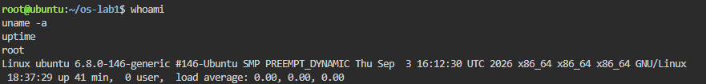
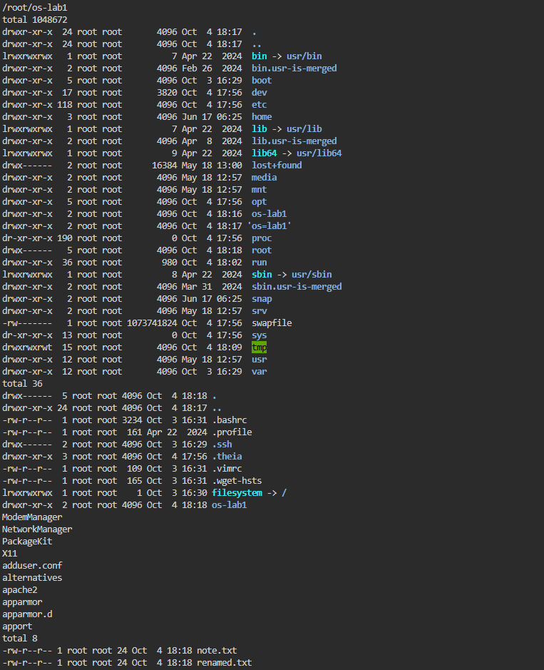
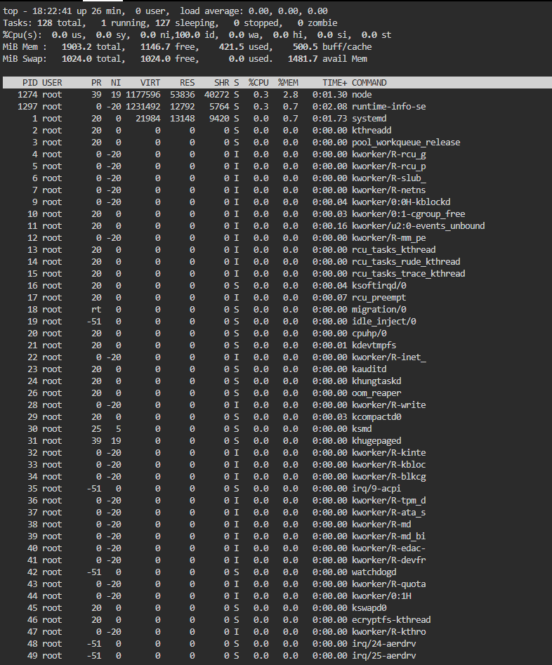
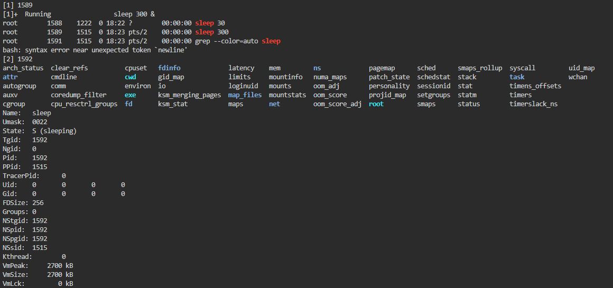
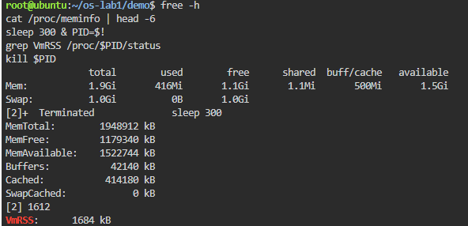
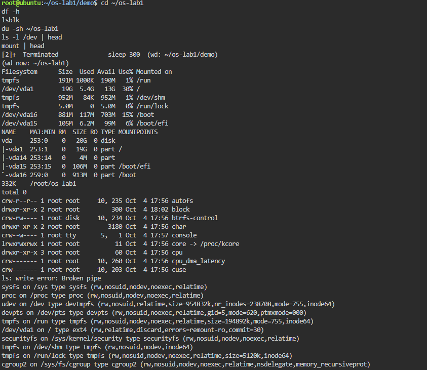
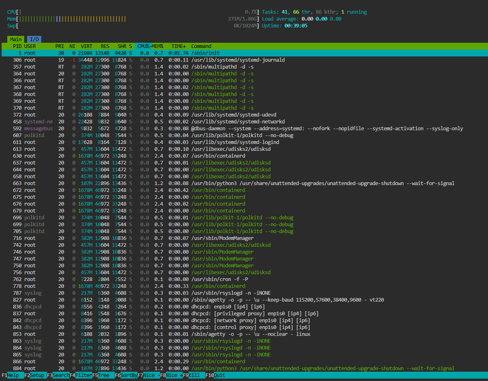
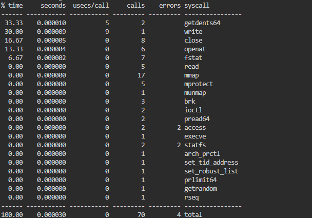

# Report: Laboratory Work No.1, Operating Systems

**Topic:** The OS as a Resource Manager
**Student:** Buliga Vladislav, FAF-243
**Checked by:** Reițman Patricia, asist. univ., DISA, FCIM, UTM
**Chișinău – 2026**

---

## 1 AIM OF THE WORK


### 1.1 Purpose of the laboratory work

The purpose of this laboratory work is to observe the operating system at work as the manager that stands between programs and the hardware. Using the Linux terminal, the four core jobs of any OS are examined directly: managing files, processes, memory and devices (I/O), and the results are interpreted, not only the commands typed.


### 1.2 Problem statement

The following tasks are required to be completed:

- explore the directory tree, create, copy, rename and delete files, and change file permissions;
- list the running processes, start a background process, find it and terminate it, and read its information from /proc;
- examine the total RAM and swap, and the memory used by a single process;
- examine the mounted filesystems, block devices and device files in /dev;
- answer the "Observe" questions for each part and summarise the four resources managed by the OS;
- optional: compare top with htop and list the system calls made by ls using strace.


## 2 THEORETICAL BACKGROUND


### 2.1 The Operating System as a Resource Manager

An operating system (OS) is the layer of software that controls the hardware and shares it between programs. From this point of view it acts as a resource manager: it decides which program gets the CPU, how much memory it may use, which files it may access and how it talks to devices. The core of the OS, the kernel, runs in privileged mode; ordinary programs run in user mode and must ask the kernel for every service.


### 2.2 File Management and Permissions

The OS turns a raw disk into a hierarchical tree of named files and directories that starts at the root "/". Every file has an owner, a group and a set of permissions. The command ls -l shows them as ten characters: the file type (- regular file, d directory, l symbolic link, c character device, b block device), followed by three groups of rwx (read, write, execute) for the owner, the group and all other users. In octal notation r=4, w=2, x=1, so chmod 600 means rw- for the owner and no rights for anyone else.


### 2.3 Processes and the /proc Filesystem

A process is a program in execution. The kernel gives each process a unique identifier (PID), its own memory space and a state (R running, S sleeping, T stopped, Z zombie). The first process started by the kernel has PID 1 (the init process, systemd on modern Linux) and is the ancestor of all other processes. Processes can be terminated with kill, which sends a signal (SIGTERM by default). The /proc directory is a virtual filesystem generated by the kernel: every process has a folder /proc/<PID>/ with live information about it, for example its state and memory usage in /proc/<PID>/status.


### 2.4 Memory Management

The OS shares physical RAM between processes and gives each one its own virtual address space. When RAM runs short, rarely used memory pages can be moved to swap, an area on the disk used as an extension of RAM. Linux also uses spare RAM as a cache for files (buff/cache), so the "available" value is a better measure of free memory than "free". The resident set size (VmRSS) of a process is the amount of its memory that is actually present in physical RAM, including shared libraries.


### 2.5 Devices and "Everything is a File"

UNIX-like systems present devices through the same interface as ordinary files. Disks, partitions, terminals and special devices appear as files in /dev, and filesystems on those devices are attached ("mounted") into the single directory tree. Block devices (such as disks) transfer data in blocks, character devices (such as terminals) transfer data as a stream of bytes. Because of this uniform interface, programs use the same calls (open, read, write, close) for files and for devices.


### 2.6 System Calls

A system call is the request a user program makes to the kernel for a service it cannot perform by itself, for example opening a file (openat), reading (read), writing (write), mapping memory (mmap) or starting a program (execve). The strace tool intercepts and lists the system calls a program makes.


## 3 DESCRIPTION OF EXERCISES

The laboratory work was carried out on an Ubuntu 24.04 virtual machine in the Killercoda online environment (Ubuntu Playground), which gives a full Linux VM with a terminal in the browser. All commands were run as the user root.


### 3.1 Getting Started

Commands used:

```bash
mkdir -p ~/os-lab1 && cd ~/os-lab1
whoami      # who am I to the OS
uname -a    # which kernel is managing this machine
uptime      # how long has this OS been running
```



*Figure 1. Output of whoami, uname -a and uptime*

Results:

- the current user is root, the administrator account with full rights;
- the kernel is Linux 6.8.0-146-generic (Ubuntu build, SMP PREEMPT_DYNAMIC, i.e. multiprocessor support and a preemptive scheduler), architecture x86_64, hostname ubuntu;
- the system had been running for 41 minutes, with a load average of 0.00, so the CPU was practically idle.


### 3.2 Task 1 — Files and Directories (File Management)

The directory tree was explored, then a working folder demo was created in which a file was created, copied, renamed and deleted, and its permissions were changed with chmod.

Commands used:

```bash
pwd
ls -la /
ls -la ~
cd /etc && ls | head

cd ~/os-lab1
mkdir demo && cd demo
echo "hello operating systems" > note.txt
cp note.txt copy.txt
mv copy.txt renamed.txt
ls -l
rm renamed.txt

ls -l note.txt
chmod 600 note.txt
ls -l note.txt
chmod 644 note.txt
```



*Figure 2. Contents of /, of the home directory and of /etc; the demo folder after cp and mv*

Interesting output: ls -la / shows a 1 GB file /swapfile with permissions -rw------- (readable only by root); this is the swap space used by the OS in Task 3. It also shows that bin, lib and sbin are symbolic links (l) to usr/bin, usr/lib and usr/sbin.

Answers to the questions:

- Owner and group: the created files belong to the user root and the group root, because the OS records the account that created a file as its owner;
- after chmod 600, ls -l shows -rw-------: "-" is a regular file, "rw-" means the owner can read and write but not execute, "---" means the group has no rights, and the last "---" means other users have no rights. After chmod 644 the file returned to -rw-r--r-- (everyone can read, only the owner can write);
- two directories under /: /etc holds the system-wide configuration files (e.g. passwd, hostname, fstab), and /home holds the personal folders of normal users. In addition, /proc is a virtual filesystem with live process information and /dev contains the device files.


### 3.3 Task 2 — Processes (Process Management)

The list of processes was examined with ps and top, then a background process was started, found and terminated, and its information was read from the /proc pseudo-filesystem.

Commands used:

```bash
ps aux | head
ps aux | wc -l       # how many processes exist right now
top                  # live view; q to quit

sleep 300 &          # run in the background, prints the PID
jobs
ps -ef | grep sleep
kill <PID>

sleep 300 &
PID=$!
ls /proc/$PID/
cat /proc/$PID/status | head -20
kill $PID
```



*Figure 3. Live list of processes in top (PID 1 = systemd, 128 tasks)*



*Figure 4. Background sleep process found with ps -ef, and its /proc/<PID>/status*

Answers to the questions:

- the process with PID 1 is systemd (started as /sbin/init). It is the first process the kernel starts after booting, it starts all system services and becomes the parent of orphaned processes, so it is the ancestor of every process on the system;
- about 128 processes were running: top reported "Tasks: 128 total, 1 running, 127 sleeping". Most of them are kernel threads (kthreadd, kworker, ksoftirqd) and background services, and almost all were sleeping (0% CPU, load average 0.00);
- for the sleep process (PID 1592) /proc/<PID>/status shows "State: S (sleeping)": the process does not use the CPU, it waits for its timer to expire. Its parent (PPid 1515) is the bash shell and Uid 0 confirms that it runs as root.

kill does not delete a program; it asks the OS to send the process a signal (SIGTERM by default), after which the kernel terminates it. The message "[2]+ Terminated sleep 300" printed by the shell confirms that the process was stopped.


### 3.4 Task 3 — Memory (Memory Management)

Commands used:

```bash
free -h                     # total / used / free RAM and swap
cat /proc/meminfo | head -6
sleep 300 & PID=$!
grep VmRSS /proc/$PID/status   # real RAM used by this process
kill $PID
```



*Figure 5. Output of free -h, /proc/meminfo and VmRSS of the sleep process*

Answers to the questions:

- the VM has 1.9 GiB of RAM in total (MemTotal: 1948912 kB): 1.1 GiB completely free, 416 MiB used by processes, 500 MiB used as buff/cache and 1.5 GiB "available";
- swap is disk space used by the OS as an extension of RAM: when physical memory runs out, rarely used pages are moved to disk. On this VM 1.0 GiB of swap is configured (the file /swapfile seen in Task 1), and 0 B of it was in use because RAM was far from full;
- a bare sleep process (PID 1612) has VmRSS = 1684 kB (about 1.6 MB). This is surprisingly large for a program that does nothing, but RSS counts every page in RAM belonging to the process, including the C library (libc) and the dynamic loader, which are shared with many other processes. The program's own code and data are only a few kilobytes.


### 3.5 Task 4 — Devices and Storage (I/O Management)

Commands used:

```bash
df -h              # mounted filesystems and free space
lsblk              # the block devices (disks)
du -sh ~/os-lab1   # size of the work folder
ls -l /dev | head  # devices presented as files
mount | head
```



*Figure 6. Output of df -h, lsblk, du, ls -l /dev and mount*

Answers to the questions:

- the root filesystem "/" is mounted on /dev/vda1, a 19 GB partition (5.4 GB used, 30%) of the 20 GB virtual disk vda. mount shows that it is formatted as ext4. The disk also has separate partitions for /boot (vda16) and /boot/efi (vda15), while /run and /dev/shm are tmpfs filesystems that exist only in RAM;
- an entry from /dev: /dev/console (crw--w---- root tty 5, 1). The first letter c marks a character device; it stands for the system console, the terminal to which the kernel writes its messages. The numbers 5, 1 (major, minor) tell the kernel which driver handles the device. Similarly, /dev/vda is the whole virtual hard disk (a block device);
- "everything is a file" means that disks, terminals and even kernel information (/proc) are accessed through the same file interface (open, read, write, close) as ordinary files, so programs do not need special code for each device.

The command ls -l /dev | head also printed "ls: write error: Broken pipe". This is expected: head exits after printing 10 lines and closes its end of the pipe; when ls tries to write more, the kernel reports that nobody is reading any more (signal SIGPIPE / error EPIPE). It is harmless and shows the OS managing communication between two processes.


### 3.6 Additional Task — htop and strace

htop was installed with apt install -y htop and used instead of top.



*Figure 7. The interactive process viewer htop*

- htop separates 41 user processes, 66 user threads and 86 kernel threads; 41 + 86 = 127, which matches the ~128 tasks reported by top;
- PID 1 is shown with its full command /sbin/init, which on Ubuntu is a link to systemd;
- system services run under separate accounts (syslog, polkitd, messagebus, dhcpcd), so each has fewer rights than root;
- the NI and PRI columns show scheduling priority: systemd-journald has nice -1 and multipathd runs with real-time (RT) priority;
- the memory (271M/1.86G) and swap (0K/1024M) bars confirm the values obtained with free -h.

Then strace -c ls was run to count the system calls made by ls.



*Figure 8. System calls made by ls, counted with strace -c*

- to list one directory, ls made 70 system calls of 21 different types, which took the kernel about 30 microseconds;
- most calls only start the program: execve loads ls, and openat, mmap (17 calls) and mprotect load and map the shared libraries into memory;
- the actual work takes only a few calls: getdents64 (2 calls) reads the directory entries and write (1 call) prints the result; together they take about 63% of the time;
- the 4 errors are normal: access fails because an optional file (/etc/ld.so.preload) does not exist, and statfs fails because SELinux is not enabled on Ubuntu.


## CONCLUSION

This laboratory work showed the operating system acting as a resource manager on a real Linux virtual machine. File management was observed with ls -l and chmod: the OS keeps a single directory tree in which every file has an owner, a group and permissions that it enforces. Process management was observed with ps, top and /proc/<PID>/status: about 128 tasks were running on an idle machine, all descending from systemd (PID 1), and each has its own PID, state and parent.

Memory management was visible with free -h and the VmRSS line: the 1.9 GiB of RAM is shared between processes and used as file cache, with 1 GiB of swap on disk as a reserve. Device management was visible with df -h and lsblk: the virtual disk vda and its partitions appear as files in /dev and are mounted into the directory tree. The additional strace experiment confirmed that a program cannot touch the disk, memory or screen by itself: even a simple ls makes 70 system calls, and every one of them is a request to the kernel.


## REFERENCES

1. Silberschatz, A., Galvin, P. B., Gagne, G. Operating System Concepts. 10th ed. Wiley, 2018.

2. Tanenbaum, A. S., Bos, H. Modern Operating Systems. 4th ed. Pearson, 2014.

3. Kerrisk, M. The Linux Programming Interface. No Starch Press, 2010.

4. The Linux man-pages project: ps(1), top(1), free(1), df(1), lsblk(8), proc(5), strace(1). Available at: https://man7.org/linux/man-pages/
