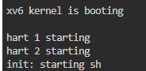
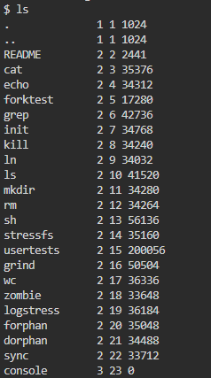
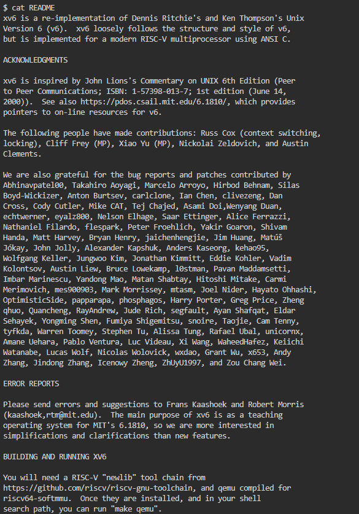
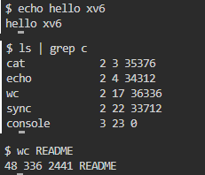
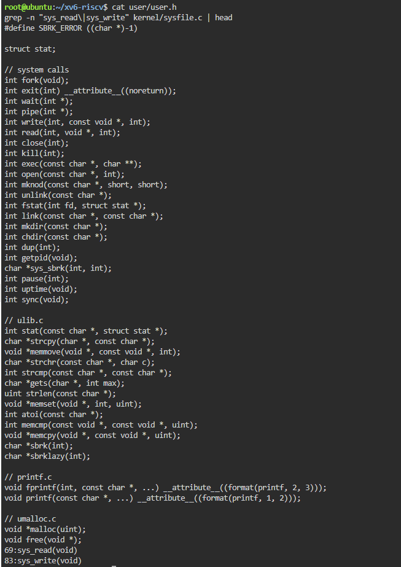
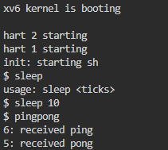

# Report: Laboratory Work No.2, Operating Systems

**Topic:** Meet the OS You Will Build (xv6)
**Student:** Buliga Vladislav, FAF-243
**Checked by:** Reițman Patricia, asist. univ., DISA, FCIM, UTM
**Chișinău – 2026**

---

## 1 AIM OF THE WORK


### 1.1 Purpose of the laboratory work

The purpose of this laboratory work is to get acquainted with xv6, the small teaching operating system that will be extended during the semester: to build it from source, boot it on an emulated RISC-V machine, use it as a Unix system, read the code of both its user programs and its kernel, and write a first user program that makes a system call into the kernel.


### 1.2 Problem statement

The following tasks are required to be completed:

- compile the xv6 kernel and user programs and boot the system in the QEMU emulator;
- use the built-in programs of xv6 (ls, cat, echo, wc) and a pipe, and compare its shell with the Linux shell;
- read the source code of user/cat.c and user/ls.c, find the list of system calls and the kernel implementation of sys_read;
- write a new user program, sleep, that pauses for a given number of clock ticks, add it to the build and test it;
- optional: write the program pingpong, in which a parent and a child process exchange one byte through two pipes.


## 2 THEORETICAL BACKGROUND


### 2.1 The xv6 Operating System

xv6 is a small teaching operating system developed at MIT. It is a modern re-implementation of Unix Version 6 (Dennis Ritchie and Ken Thompson, 1975) written in about 9,000 lines of ANSI C for a RISC-V multiprocessor. Despite its size it is a real Unix: it has processes, virtual memory, a file system, pipes and a shell, and it is small enough that the whole system can be read and understood.


### 2.2 Cross-compilation and the QEMU Emulator

xv6 runs on the RISC-V architecture, while the development machine is x86-64. Therefore it is compiled with a cross-compiler (riscv64-linux-gnu-gcc), which runs on x86-64 but produces RISC-V machine code. The result is executed in QEMU, an emulator that simulates a complete RISC-V computer (the "virt" machine) with several CPU cores (harts), 128 MB of RAM and a virtual disk containing the xv6 file system image fs.img. The command make qemu builds everything and starts the emulator.


### 2.3 Kernel Space and User Space

The source of xv6 is split into two folders, which reflects the main structure of any operating system. The kernel/ folder contains the operating system itself: the scheduler, memory management, the file system and the system-call handlers. It runs in privileged (supervisor) mode with full access to the hardware. The user/ folder contains ordinary programs such as ls, cat, echo and the shell sh, which run in unprivileged user mode, are isolated from each other and cannot access the hardware directly.


### 2.4 System Calls

A system call is the only way for a user program to request a service from the kernel. In xv6 the available system calls are declared in user/user.h (fork, exit, wait, pipe, read, write, open, close, exec, pause, getpid and others). When a program calls one of them, a small stub executes the RISC-V ecall instruction, the CPU switches to supervisor mode and the kernel runs the corresponding function, for example sys_read in kernel/sysfile.c, then returns the result to the program.


### 2.5 Processes and Pipes

New processes are created with fork(), which makes a copy of the calling process, and exec(), which replaces the program of a process with another one. A pipe, created with pipe(), is a kernel buffer with a read end and a write end, both represented by file descriptors. One process writes into it and another reads from it, which allows two processes to communicate. The shell uses fork, exec, pipe and dup to run commands such as ls | grep c.


## 3 DESCRIPTION OF EXERCISES

The laboratory work was carried out on an Ubuntu 24.04 virtual machine in the Killercoda online environment. Since the toolchain was not preinstalled there, it was installed first, then the course copy of xv6 was cloned from GitHub.

```bash
apt update && apt install -y git build-essential qemu-system-misc \
    gcc-riscv64-linux-gnu binutils-riscv64-linux-gnu
git clone https://github.com/mit-pdos/xv6-riscv ~/xv6-riscv
cd ~/xv6-riscv
```


### 3.1 Task 1 — Building and Booting xv6

The command make qemu compiled the kernel and all user programs with the RISC-V cross-compiler, created the file system image fs.img and started the emulator. After a few seconds the kernel booted, started the other CPU cores (hart 1 and hart 2) and the init process started the shell, which displayed the $ prompt. To leave xv6 the QEMU sequence Ctrl-A, then X is used.

```bash
make qemu
```



*Figure 1. xv6 booting in QEMU*


### 3.2 Task 2 — Using xv6 as a Unix System

At the xv6 prompt the built-in programs were run: ls lists the files of the root directory (name, type, inode number and size), cat prints the README file, echo prints its arguments, ls | grep c filters the list through a pipe and wc counts lines, words and bytes.

```bash
$ ls
$ cat README
$ echo hello xv6
$ ls | grep c
$ wc README
```



*Figure 2. Contents of the xv6 root directory (ls)*



*Figure 3. The README file of xv6 (cat README)*



*Figure 4. echo, a pipe (ls | grep c) and wc inside xv6*

Answers to the questions:

- three programs xv6 ships with: ls, cat and echo (also grep, wc, sh, kill, mkdir, rm, usertests and others). In the ls output they have type 2 (regular file), while console has type 3 (device);
- for a pipe to work, the OS must provide process creation (fork and exec), because the shell runs ls and grep as two separate processes at the same time, and inter-process communication: the pipe() system call creates a kernel buffer with a read end and a write end, ls writes into it and grep reads from it, and the shell connects them to standard output and standard input with close and dup;
- the xv6 shell works like the Linux shell from Lab 1 (prompt, commands, pipes, redirection with < and >, background jobs with &), but it is much more minimal: it has no command history, tab completion, environment variables, job control or scripting.

wc README printed 48 lines, 336 words and 2441 bytes; the size 2441 is the same as the one shown for README by ls.


### 3.3 Task 3 — Reading the Source Code

After quitting QEMU the source tree was examined. The user programs user/ls.c and user/cat.c were read, then the list of system calls available to programs (user/user.h) and the kernel functions that implement read and write were found.

```bash
sed -n "1,40p" user/ls.c
sed -n "1,30p" user/cat.c
cat user/user.h
grep -n "sys_read\|sys_write" kernel/sysfile.c | head
```



*Figure 5. System calls declared in user/user.h and location of sys_read and sys_write*

Answers to the questions:

- user/cat.c uses the following system calls: open(name, O_RDONLY) asks the kernel to open a file and return a file descriptor; read(fd, buf, n) asks the kernel to copy up to n bytes from the file into the program's buffer; write(1, buf, n) asks the kernel to write the bytes to file descriptor 1 (the console); close(fd) releases the file descriptor; exit(status) ends the process and frees its resources. The error messages printed with fprintf(2, ...) also end up as write calls on descriptor 2;
- sys_read is implemented in kernel/sysfile.c, on line 69 (sys_write is on line 83). It reads the arguments of the call (argaddr, argint, argfd) and then calls fileread();
- the code in kernel/ is the operating system itself and runs in privileged mode with direct access to the hardware, while the code in user/ consists of ordinary programs that run in user mode and can only obtain services by asking the kernel through system calls.

user/user.h also shows that in the current version of xv6 the system call that pauses a process is named pause(int), not sleep(int) as in older versions and in the laboratory instructions. This matters for the next task.


### 3.4 Task 4 — Writing the sleep Program

The program sleep takes one argument, the number of clock ticks to wait. It checks that exactly one argument is given (otherwise it prints a usage message to the standard error stream, descriptor 2, and exits with status 1), converts the argument to a number with atoi and makes the system call that suspends the process. Because the user-level sleep() call was renamed to pause() in the current xv6, the code given in the instructions (sleep(atoi(argv[1]))) does not compile; the program therefore calls pause(), which performs exactly the same system call (sys_pause in the kernel).

Source code (user/sleep.c):

```bash
#include "kernel/types.h"
#include "user/user.h"

// sleep: pause for a given number of clock ticks.
// In current xv6-riscv the sleep() system call was renamed to pause().

int
main(int argc, char *argv[])
{
  if(argc != 2){
    fprintf(2, "usage: sleep <ticks>\n");
    exit(1);
  }
  pause(atoi(argv[1]));   // system call into the kernel
  exit(0);
}
```

The program was added to the list of user programs (UPROGS) in the Makefile, so that it is compiled and copied into the file system image:

```bash
UPROGS=\
    $U/_cat\
    $U/_echo\
    $U/_sleep\
    $U/_pingpong\
    ...
```

Then xv6 was rebuilt with make qemu and the program was tested. Called without arguments it prints the usage message; sleep 10 pauses for 10 ticks (about one second, since the xv6 timer interrupt occurs roughly every 100 ms) and then returns to the prompt.



*Figure 6. Testing sleep and pingpong inside xv6*


### 3.5 Additional Task — pingpong

The program pingpong creates two pipes, one from the parent to the child and one from the child to the parent, and then a child process with fork(). The parent writes one byte into the first pipe; the child reads it, prints "<pid>: received ping" and writes the byte back through the second pipe; the parent reads it, prints "<pid>: received pong" and waits for the child to finish. Each process closes the pipe ends it does not use.

Source code (user/pingpong.c):

```bash
#include "kernel/types.h"
#include "user/user.h"

int
main(int argc, char *argv[])
{
  int p2c[2], c2p[2];
  char b = 'x';

  if(pipe(p2c) < 0 || pipe(c2p) < 0){
    fprintf(2, "pingpong: pipe failed\n");
    exit(1);
  }
  int pid = fork();
  if(pid < 0){
    fprintf(2, "pingpong: fork failed\n");
    exit(1);
  }
  if(pid == 0){                 // child
    close(p2c[1]); close(c2p[0]);
    read(p2c[0], &b, 1);
    printf("%d: received ping\n", getpid());
    write(c2p[1], &b, 1);
    exit(0);
  } else {                      // parent
    close(p2c[0]); close(c2p[1]);
    write(p2c[1], &b, 1);
    read(c2p[0], &b, 1);
    printf("%d: received pong\n", getpid());
    wait(0);
    exit(0);
  }
}
```

The output (Figure 7) shows "6: received ping" and "5: received pong": the child received PID 6 and the parent PID 5, which confirms that fork() created a new process and that the two processes exchanged data through the kernel.


## CONCLUSION

In this laboratory work the xv6 operating system was built from source with a RISC-V cross-compiler and booted on an emulated RISC-V computer in QEMU. Using its shell showed that even an operating system of about 9,000 lines provides the basic Unix abstractions familiar from Linux: files, processes and pipes.

Reading the source made the division between kernel/ and user/ concrete: a program such as cat only asks for services through system calls like read and write, and the kernel function sys_read in kernel/sysfile.c (line 69) does the actual work. Finally, a new user program, sleep, was written, added to the build and run, making a real system call into a kernel compiled by hand; along the way it turned out that the current xv6 names this call pause(). The optional pingpong program additionally demonstrated process creation with fork() and communication between processes through pipes.


## REFERENCES

1. Cox, R., Kaashoek, F., Morris, R. xv6: a simple, Unix-like teaching operating system (RISC-V version). MIT, 2024. Available at: https://pdos.csail.mit.edu/6.1810/

2. MIT PDOS. xv6-riscv source code repository. Available at: https://github.com/mit-pdos/xv6-riscv

3. Silberschatz, A., Galvin, P. B., Gagne, G. Operating System Concepts. 10th ed. Wiley, 2018.

4. Lions, J. Lions' Commentary on UNIX 6th Edition, with Source Code. Peer-to-Peer Communications, 1996.
