# Report on laboratory work no. 3

**Course:** Operating Systems  
**Topic:** The Command Line: Shell, Pipes and Text Filters  
**Done by:** st. gr. FAF-243, Buliga Vladislav  
**Checked by:** Reițman Patricia, asist. univ.  
Chișinău, 2026

---

## 1 AIM OF THE WORK


### 1.1 Purpose of the laboratory work

The purpose of this laboratory work is to learn to work efficiently in the bash command line: to move fast using completion, history and the built-in help, to predict what the shell does to a command line before it runs (globbing, quoting, expansions), to redirect input, output and errors, to chain commands and control background jobs, and to answer real questions about data with one-line pipelines of small text filters. Finally, the best one-liners are turned into a first shell script.


### 1.2 Problem statement

The following tasks are required to be completed:

- use Tab completion, reverse history search (Ctrl+R), type, which, $PATH, man and help;
- predict and then check the result of globbing, quoting and expansion on a set of test files;
- redirect standard output and standard error, compare the order of redirections, chain commands with ; && || and control a background job;
- answer questions Q1–Q8 about an artificial web access log with one-line pipelines saved in oneliners.sh;
- write the script report.sh that summarises the log and reports the failures of each user.


## 2 THEORETICAL BACKGROUND


### 2.1 The Shell

The shell (here bash) is an ordinary user program that reads command lines, transforms them and asks the kernel to run the requested programs, using the fork, exec and wait system calls. Before a program starts, the shell performs several expansions on the line: brace expansion ({1..5}), variable expansion ($HOME), command substitution ($(date)), arithmetic expansion ($((7*6))), word splitting and filename expansion (globbing: *, ?, [a-b]). Finally it removes the quotes and passes the resulting list of words to the program as argv.


### 2.2 Built-in and External Commands, PATH

Some commands are built into the shell (cd, echo, type, help, jobs), others are separate executable files (ls, grep, sort). When an external command is typed without a path, the shell searches for it in the directories listed in the PATH variable, from left to right. A command that cannot be found ends with the exit code 127. Every command returns an exit code, stored in $?: 0 means success, any other value means an error.


### 2.3 Quoting

Single quotes keep everything literally: no expansion at all happens inside them. Double quotes keep spaces and glob characters literally but still allow $ expansions and command substitution. A backslash protects only the next character. Quotes are needed whenever an argument contains spaces or special characters, for example a file name such as "alfa beta.txt".


### 2.4 Standard Streams and Redirection

Every process starts with three open file descriptors: 0 – standard input, 1 – standard output and 2 – standard error. The shell can connect them to files before the program starts: > file (overwrite), >> file (append), < file (input), 2> file (errors), 2>&1 (make descriptor 2 a copy of descriptor 1). Redirections are processed from left to right. A pipe (|) connects the standard output of one process to the standard input of the next, so small filters (grep, cut, sort, uniq, wc, head, tail, tr) can be combined into a pipeline.


### 2.5 Command Lists and Jobs

Commands can be chained with ; (run one after another), && (run the next only if the previous one succeeded) and || (run the next only if the previous one failed). A command followed by & runs in the background as a job; jobs lists the jobs of the shell, and kill %N sends a signal to job number N.


### 2.6 Shell Scripts

A script is a text file with shell commands. The first line #!/bin/bash (the "shebang") tells the kernel which interpreter must run the file. To be started directly the file needs the execute permission (chmod +x). Scripts receive arguments as $1, $2, ..., use variables, conditions (if [ ... ]), loops (for) and return an exit code with exit.


## 3 DESCRIPTION OF EXERCISES

The work was done in bash on an Ubuntu Linux virtual machine. First the working directory ~/os-lab3 was created and the data set for Part 4, an artificial web access log of 500 lines, was generated:

```
mkdir -p ~/os-lab3 && cd ~/os-lab3
for i in $(seq 1 500); do
  echo "2026-10-05 10:$(printf %02d $((i % 60))) user$((i % 7)) $([ $((i % 5)) -eq 0 ] && echo FAIL || echo OK) /page$((i % 4))"
done > access.log
head -3 access.log ; wc -l access.log
```

The check printed "500 access.log", so the file is correct. Each line has the form "2026-10-05 10:01 user1 OK /page1": date, time, user, result and page. Since i % 5 == 0 marks a failure, exactly 100 of the 500 requests are FAIL.


### 3.1 Part 1 — Move Fast, Find Help

Tab completion: after typing ls /usr/sh and pressing Tab, bash completed the only match to /usr/share/; pressing Tab a second time wanted to list all the entries inside /usr/share and, because there are 143 of them, first asked "Display all 143 possibilities? (y or n)". Typing cd /et and pressing Tab once completed it immediately to cd /etc/, because /etc is the only directory in / that starts with "et". When the prefix is unique, one Tab completes it; when there are several candidates, the second Tab shows them.

<p align="center">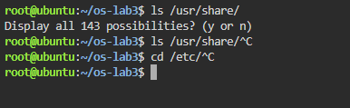</p>

<p align="center"><i>Figure 1.1 – Tab completion</i></p>

Reverse history search: after running three commands, Ctrl+R opened the prompt (reverse-i-search) and typing a few letters of the first command found it in the history; Enter executed it again without retyping it.

```
type cd ; type ls ; type echo ; which ls
echo $PATH
echo $PATH | tr ':' '\n'
nosuchprog ; echo "exit code: $?"
```

<p align="center">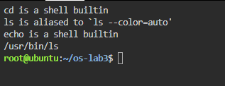</p>

<p align="center"><i>Figure 1.2 – Output of type and which</i></p>

<p align="center">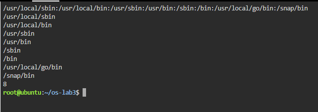</p>

<p align="center"><i>Figure 1.3 – The directories in PATH</i></p>

<p align="center">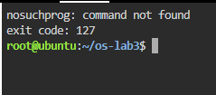</p>

<p align="center"><i>Figure 1.4 – Exit code of a missing command</i></p>

Help without a browser: man ls opens the manual (inside it /sort searches, n jumps to the next match, q quits), ls --help prints a short summary, man -k "list directory" searches the descriptions of all manual pages, and help cd shows the help of a bash built-in.

```
man ls
ls --help | head
man -k "list directory"
help cd
```

Answers to the questions:

1. cd and echo are shell built-ins, while ls is an external program (/usr/bin/ls); in the interactive shell type ls also shows that ls is an alias for ls --color=auto, which only adds colours before the real program /usr/bin/ls is run. cd MUST be a built-in because the current directory is a property of each process: an external cd program would run in a child process, change only its own directory and then exit, leaving the shell where it was.
2. PATH contains 8 directories (/usr/local/sbin, /usr/local/bin, /usr/sbin, /usr/bin, /sbin, /bin, /usr/local/go/bin, /snap/bin); ls is found in /usr/bin, as which ls shows.
3. A command that is not found returns the exit code 127 ("nosuchprog: command not found", then exit code: 127).
4. The option -t sorts by modification time, newest first (found in man ls with /time); ls -ltr shows the oldest first.


### 3.2 Part 2 — What the Shell Does to Your Line

A test directory with a few files, one of them with a space in its name, was created:

```
mkdir -p ~/os-lab3/play && cd ~/os-lab3/play
touch a.c b.c file1.txt file2.txt notes.txt "alfa beta.txt"
ls
```

<p align="center">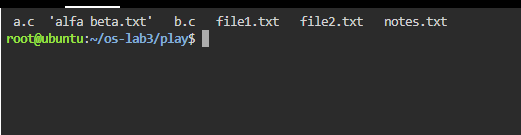</p>

<p align="center"><i>Figure 2.1 – Files created in the play directory</i></p>

For every line below the result was first predicted, then the command was run. The results are summarised in Table 1.

Table 1 – Predictions and real outputs

| Command | My prediction | Real output | Explanation |
|---|---|---|---|
| `echo *.c` | a.c b.c | a.c b.c | Same. The shell replaced *.c with the matching file names, sorted alphabetically. |
| `echo file?.txt` | file1.txt file2.txt | file1.txt file2.txt | Same. ? matches exactly one character. |
| `echo [a-b]*` | a.c alfa beta.txt b.c | a.c alfa beta.txt b.c | Same. Names starting with a or b; "alfa beta.txt" is one word even though it contains a space. |
| `echo *.xyz` | *.xyz | *.xyz | Same. When nothing matches, bash leaves the pattern unchanged. |
| `ls alfa beta.txt` | error for alfa and for beta.txt | ls: cannot access 'alfa' ... and 'beta.txt': No such file or directory | Same. Without quotes the name is split into two arguments. |
| `ls "alfa beta.txt"` | alfa beta.txt | 'alfa beta.txt' | ls prints the name in quotes because it contains a space. |
| `echo '$HOME' "$HOME" \$HOME` | $HOME /root $HOME | $HOME /root $HOME | Same. Only the double-quoted $HOME was expanded. |
| `echo {1..5} ; echo $((7 * 6))` | 1 2 3 4 5 / 42 | 1 2 3 4 5 / 42 | Same. Brace expansion and arithmetic expansion. |
| `echo "today is $(date +%A), I am $(whoami)"` | today is Sunday, I am root | today is Sunday, I am root | Same. Command substitution works inside double quotes. |
| `touch log{1..3}.txt && ls log*` | log1.txt log2.txt log3.txt | log1.txt log2.txt log3.txt | Same. Braces created three names, then the glob found them. |

<p align="center">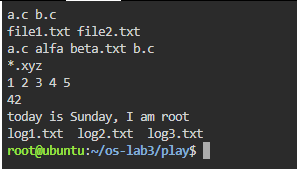</p>

<p align="center"><i>Figure 2.2 – Globbing results</i></p>

<p align="center">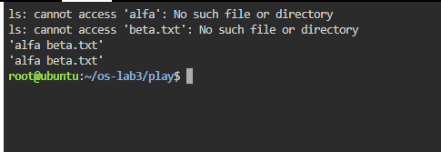</p>

<p align="center"><i>Figure 2.3 – The ls error on a name with a space, and the fix</i></p>

<p align="center">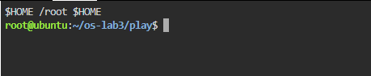</p>

<p align="center"><i>Figure 2.4 – Single quotes, double quotes and backslash</i></p>

Answers to the questions:

1. The predictions and real outputs are given in Table 1.
2. The file names were produced by the shell, not by echo. Before running echo, bash performs filename expansion: it replaces *.c with the list of matching names and only then starts echo with the arguments "a.c" and "b.c". echo simply prints the arguments it receives.
3. ls alfa beta.txt failed because the shell splits the line at spaces, so ls received two arguments, "alfa" and "beta.txt", and neither file exists. Two fixes: quote the name, ls "alfa beta.txt" (or 'alfa beta.txt'), or escape the space, ls alfa\ beta.txt. A third option is a glob: ls alfa*.
4. Single quotes prevent every expansion: '$HOME' prints $HOME literally. Double quotes keep spaces and glob characters literally but still expand $variables, $(commands) and $((arithmetic)): "$HOME" prints the home directory.

ls shows the file as 'alfa beta.txt' (in quotes) because, when writing to a terminal, GNU ls quotes names that contain spaces or special characters, so the user can see where the name begins and ends and can copy it back into a command line safely.


### 3.3 Part 3 — Redirection, Chaining and Jobs

```
cd ~/os-lab3
ls /etc /nope > out.txt 2> err.txt
wc -l out.txt ; cat err.txt
ls /etc /nope > all.txt 2>&1 ; tail -2 all.txt
```

<p align="center">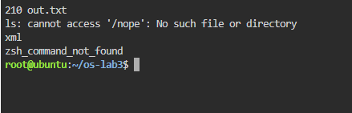</p>

<p align="center"><i>Figure 3.1 – stdout and stderr in separate files</i></p>

```
ls /etc /nope > all.txt 2>&1
ls /etc /nope 2>&1 > all.txt
```

<p align="center">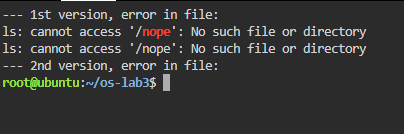</p>

<p align="center"><i>Figure 3.2 – Comparing the order of redirections</i></p>

```
echo first > notes.md ; echo second >> notes.md ; cat notes.md
wc -l < access.log
ls /nope 2> /dev/null || echo "failed with code $?"
mkdir -p tmp && cd tmp && echo "I am in $(pwd)" ; cd ~/os-lab3
```

<p align="center">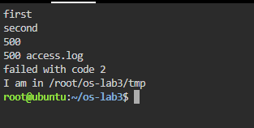</p>

<p align="center"><i>Figure 3.3 – The ; && || operators</i></p>

```
sleep 100 &
jobs ; kill %1 ; jobs
```

<p align="center">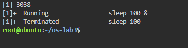</p>

<p align="center"><i>Figure 3.4 – Running a background job and stopping it</i></p>

Results: echo first > notes.md created the file, and >> appended the second line, so cat printed "first" and "second". wc -l < access.log printed 500. ls /nope 2> /dev/null printed nothing (the error went to /dev/null) and, because it failed, || ran echo, which printed "failed with code 2". The line with && changed into tmp and printed "I am in /root/os-lab3/tmp". sleep 100 & started a background job, jobs showed it as Running, kill %1 terminated it and the next jobs reported "Terminated".

Answers to the questions:

1. The error message "ls: cannot access '/nope': No such file or directory" went to err.txt (standard error, descriptor 2), and the listing of /etc went to out.txt (standard output, descriptor 1), which has 210 lines.
2. > all.txt 2>&1 first sends stdout to all.txt and then makes stderr a copy of the new stdout, so both the listing and the error end up in the file. 2>&1 > all.txt first makes stderr a copy of the current stdout (the terminal) and only then moves stdout to the file, so the error is still printed on the screen and only the listing goes to all.txt. Redirections are applied from left to right, and 2>&1 copies where descriptor 1 points at that moment.
3. With wc -l < access.log the shell opens the file and connects it to the standard input of wc, so wc reads anonymous data and does not know any file name; it prints only the number. With wc -l access.log, wc receives the name as an argument, opens the file itself and prints the count together with the name.
4. ; runs the commands one after another, whatever their result. && runs the next command only if the previous one succeeded (exit code 0). || runs the next command only if the previous one failed (exit code not 0).


### 3.4 Part 4 — Answer Questions with One-Liners

Every question was answered with one command line built from small filters joined by pipes. All the lines are saved in oneliners.sh, each with its question as a comment, and the file runs with bash oneliners.sh inside ~/os-lab3. In the log the fields are separated by spaces: field 2 is the time, 3 the user, 4 the result and 5 the page.

**Q1. How many requests failed?**

```
grep -c FAIL access.log
```

<p align="center">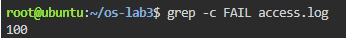</p>

<p align="center"><i>Figure 4.1 – Number of failed requests</i></p>

100 requests failed. grep -c counts the matching lines.

**Q2. How many different pages were requested, and which?**

```
cut -d' ' -f5 access.log | sort -u | paste -sd' ' | awk '{print NF " pages: " $0}'
```

<p align="center">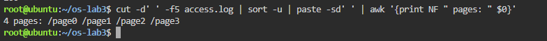</p>

<p align="center"><i>Figure 4.2 – Different pages requested</i></p>

4 different pages: /page0, /page1, /page2, /page3. cut takes the page field, sort -u keeps each value once, paste joins them on one line and awk counts them.

**Q3. How many requests did each page get?**

```
cut -d' ' -f5 access.log | sort | uniq -c
```

<p align="center">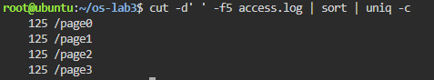</p>

<p align="center"><i>Figure 4.3 – Requests per page</i></p>

Each page got 125 requests; 4 × 125 = 500, which matches the number of lines in the log.

**Q4. Which user or users have the most failed requests, and how many?**

```
grep FAIL access.log | cut -d' ' -f3 | sort | uniq -c | sort -k1,1nr -k2,2 | awk 'NR==1{max=$1} $1==max'
```

<p align="center">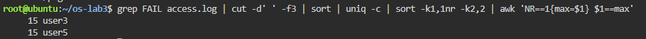</p>

<p align="center"><i>Figure 4.4 – Users with the most failed requests</i></p>

user3 and user5, with 15 failed requests each (all the other users have 14). The pipeline counts failures per user, sorts them in descending order and prints every user that has the maximum, so a tie is not hidden. Check: 14 × 5 + 15 × 2 = 100, equal to Q1.

**Q5. How many requests did user3 make, and how many of them failed?**

```
echo "user3: $(grep -c ' user3 ' access.log) requests, $(grep ' user3 ' access.log | grep -c FAIL) failed"
```

<p align="center">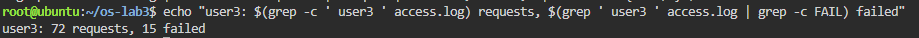</p>

<p align="center"><i>Figure 4.5 – Requests and failures of user3</i></p>

user3 made 72 requests, 15 of which failed. The spaces around user3 make sure that only the user field matches.

**Q6. Print the last 3 failed requests, showing only time and user.**

```
grep FAIL access.log | tail -3 | cut -d' ' -f2,3
```

<p align="center">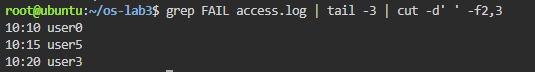</p>

<p align="center"><i>Figure 4.6 – The last 3 failed requests</i></p>

The last three failures are 10:10 user0, 10:15 user5 and 10:20 user3 (lines 490, 495 and 500 of the log).

**Q7. Which login shells appear in /etc/passwd, and how many accounts use each?**

```
cut -d: -f7 /etc/passwd | sort | uniq -c | sort -rn
```

<p align="center">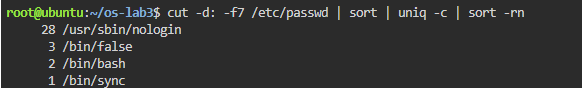</p>

<p align="center"><i>Figure 4.7 – Login shells in /etc/passwd</i></p>

28 accounts use /usr/sbin/nologin and 3 use /bin/false: these are system accounts (services such as daemon, www-data, syslog) that are not allowed to log in; 2 accounts use /bin/bash (accounts that can log in, such as root), and 1 account, sync, uses /bin/sync. In total 34 accounts, the number of lines in /etc/passwd.

**Q8. Why do ls /etc | wc -l and ls -l /etc | wc -l differ by exactly one?**

```
ls /etc | wc -l ; ls -l /etc | wc -l
```

<p align="center">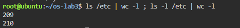</p>

<p align="center"><i>Figure 4.8 – ls versus ls -l line count</i></p>

Prediction: ls -l prints one extra line. Result: ls /etc | wc -l printed 209 and ls -l /etc | wc -l printed 210. When its output goes into a pipe, ls prints one name per line, and ls -l prints one line per entry as well, but adds a first line "total N" (the disk blocks used by the listed files). That extra line is the difference of exactly one.

The complete file oneliners.sh:

```
#!/bin/bash
# Lab 3, Part 4 - one-liners on access.log
# Run inside ~/os-lab3:  bash oneliners.sh
# Each line of access.log: date time user result(OK/FAIL) page

# Q1. How many requests failed?
grep -c FAIL access.log

# Q2. How many different pages were requested, and which?
cut -d' ' -f5 access.log | sort -u | paste -sd' ' | awk '{print NF " pages: " $0}'

# Q3. How many requests did each page get?
cut -d' ' -f5 access.log | sort | uniq -c

# Q4. Which user or users have the most failed requests, and how many?
grep FAIL access.log | cut -d' ' -f3 | sort | uniq -c | sort -k1,1nr -k2,2 | awk 'NR==1{max=$1} $1==max'

# Q5. How many requests did user3 make, and how many of them failed?
echo "user3: $(grep -c ' user3 ' access.log) requests, $(grep ' user3 ' access.log | grep -c FAIL) failed"

# Q6. Print the last 3 failed requests, showing only time and user.
grep FAIL access.log | tail -3 | cut -d' ' -f2,3

# Q7. Which login shells appear in /etc/passwd, and how many accounts use each? (field 7, separator :)
cut -d: -f7 /etc/passwd | sort | uniq -c | sort -rn

# Q8. Why do ls /etc | wc -l and ls -l /etc | wc -l differ by exactly one?
echo "ls: $(ls /etc | wc -l)  ls -l: $(ls -l /etc | wc -l)  (ls -l adds the 'total N' line)"

# Bonus. Lines where the minute ends in 0 and the request failed (grep -E):
grep -E ' 10:[0-5]0 .* FAIL ' access.log | wc -l
```

<p align="center">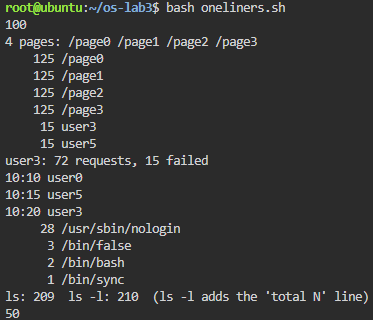</p>

<p align="center"><i>Figure 4.9 – Full run of oneliners.sh</i></p>

Self-check: the Q3 counts add up to 500 and the per-user failure counts behind Q4 (14, 14, 14, 15, 14, 15, 14) add up to 100, the answer to Q1.

**Bonus. Lines where the minute ends in 0 and the request failed (grep -E):**

```
grep -E ' 10:[0-5]0 .* FAIL ' access.log | wc -l
```

<p align="center">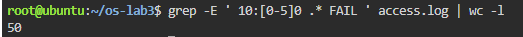</p>

<p align="center"><i>Figure 4.10 – Failed requests at minutes ending in 0</i></p>

There are 50 such lines. The extended regular expression 10:[0-5]0 matches the minutes 00, 10, 20, 30, 40, 50, and " FAIL " keeps only the failed requests. In fact every request at such a minute failed: the minute is i % 60, so a minute ending in 0 means i is divisible by 10, and therefore also by 5, which is the FAIL condition. 500 / 10 = 50.


### 3.5 Part 5 — The First Script

The best one-liners were turned into the script report.sh. The TODO was completed with a for loop over the users 0 to 6 which, for each user, selects his lines and counts the failed ones:

```
#!/bin/bash
# usage: ./report.sh access.log
log=$1
if [ ! -f "$log" ]; then
       echo "no such file: $log" >&2
       exit 1
fi
total=$(wc -l < "$log")
fails=$(grep -c FAIL "$log")
echo "$total requests, $fails failed"
# for each of user0 ... user6, print "userN: X failures"
for n in $(seq 0 6); do
       echo "user$n: $(grep " user$n " "$log" | grep -c FAIL) failures"
done
```

<p align="center">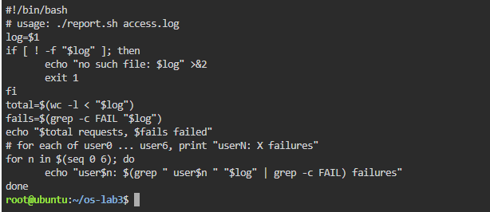</p>

<p align="center"><i>Figure 5.1 – Contents of report.sh</i></p>

```
chmod +x report.sh
./report.sh access.log
./report.sh nope.log ; echo "exit code: $?"
```

<p align="center">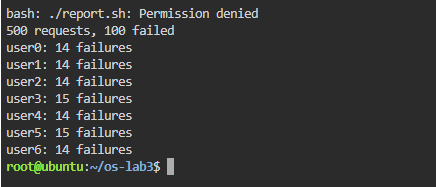</p>

<p align="center"><i>Figure 5.2 – Running the script on access.log</i></p>

<p align="center">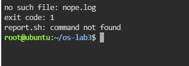</p>

<p align="center"><i>Figure 5.3 – Error handling for a missing file</i></p>

The script printed "500 requests, 100 failed" followed by the failures of each user (user0: 14, user1: 14, user2: 14, user3: 15, user4: 14, user5: 15, user6: 14), the same values as in Part 4. For a missing file it printed "no such file: nope.log" and the exit code was 1.

Answers to the questions:

1. The first line #!/bin/bash (shebang) tells the kernel which interpreter must execute the file when it is started as a program: the kernel runs /bin/bash with the script as its argument. Before chmod +x the file has no execute permission, so ./report.sh fails with "Permission denied" (exit code 126); it could still be run as bash report.sh.
2. The current directory is not in PATH (for safety), so for report.sh the shell searches only the PATH directories and answers "command not found". ./report.sh gives an explicit path (the file report.sh in the current directory .), so no PATH search is done.
3. >&2 sends the error message to standard error, so it is not mixed with the normal output: if the output of the script is redirected to a file or a pipe, the error still appears on the screen. exit 1 ends the script with a non-zero exit code, so the calling program or shell (for example with && or ||, or cron) can detect that the script failed.

**Bonus. Running the script with cron**

A line was added to the crontab (crontab -e) that runs report.sh every minute and appends its output, including errors, to report.log, using full paths because cron runs with a minimal environment and a different working directory:

```
* * * * * /root/os-lab3/report.sh /root/os-lab3/access.log >> /root/os-lab3/report.log 2>&1
```

<p align="center">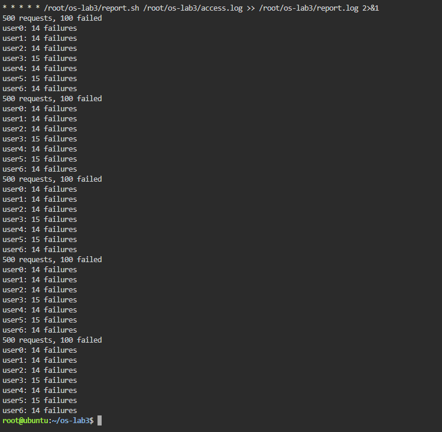</p>

<p align="center"><i>Figure 5.4 – The crontab line and report.log after two minutes</i></p>

crontab -l confirmed the line. A few minutes later report.log contained the report five times, one block of 8 lines for every minute in which cron ran the script, with identical results each time. The line was then removed with crontab -r.


## CONCLUSION

This laboratory work showed that the shell is much more than a program launcher: before any command runs, bash rewrites the line by expanding braces, variables, command substitutions and arithmetic, splitting words, expanding glob patterns into file names and removing quotes. This explains why echo *.c prints file names although echo knows nothing about files, and why a file name with a space must be quoted. Built-ins such as cd must run inside the shell process itself, while external commands are found through PATH.

Redirection and pipes connect the three standard streams of processes to files and to each other; the order of redirections matters because they are applied from left to right. With small filters (grep, cut, sort, uniq, wc, head, tail) joined by pipes, all the questions about the 500-line access log were answered with single command lines, and the results were checked against each other (125 × 4 = 500 requests, 100 failures). Finally, the one-liners were turned into a script with argument checking, a loop, error output on stderr and a meaningful exit code, which can also be run automatically by cron.


## REFERENCES

1. GNU Bash Reference Manual. Free Software Foundation. Available at: https://www.gnu.org/software/bash/manual/

2. Shotts, W. The Linux Command Line. 2nd ed. No Starch Press, 2019.

3. GNU Coreutils manual (ls, cut, sort, uniq, wc, head, tail). Available at: https://www.gnu.org/software/coreutils/manual/

4. Silberschatz, A., Galvin, P. B., Gagne, G. Operating System Concepts. 10th ed. Wiley, 2018.
