# Report on laboratory work no. 4

**Course:** Operating Systems  
**Topic:** The xv6 Shell from the Outside  
**Done by:** st. gr. FAF-243, Buliga Vladislav  
**Checked by:** Reițman Patricia, asist. univ.  
Chișinău, 2026

---

## 1 AIM OF THE WORK


### 1.1 Purpose of the laboratory work

The purpose of this laboratory work is to understand what a shell must do and what bash adds on top of it, by using the xv6 shell (user/sh.c, about 500 lines) side by side with bash. A small program that prints the arguments it receives shows exactly who expands the * pattern and who removes the quotes. In addition, the sleep program from Lab 2 is checked against the current version of xv6, in which the sleep() system call was renamed to pause().


### 1.2 Problem statement

The following tasks are required to be completed:

- check which name of the sleep system call the xv6 tree uses, update user/sleep.c, build and test it;
- run the same set of commands in bash and in the xv6 shell and compare the results in a table;
- write the program args (for xv6) and args_linux (for Linux) that print argc and argv, and run the same lines in both shells;
- read user/sh.c: the kinds of commands it knows, where they are executed, how cd is handled and whether * or $ are processed.


## 2 THEORETICAL BACKGROUND


### 2.1 What a Shell Must Do

A shell is an ordinary user program that repeatedly prints a prompt, reads a line, parses it and asks the kernel to run it. For an external command it calls fork() to create a child process, the child calls exec() to replace itself with the requested program, and the parent waits for it with wait(). Redirections are implemented by closing a file descriptor and opening a file in its place, pipes by pipe() and dup(), and background jobs simply by not waiting for the child.


### 2.2 The xv6 Shell

The xv6 shell, user/sh.c, implements only this core. It parses a line into a tree of five kinds of commands: EXEC (a simple command), REDIR (< > >>), PIPE (|), LIST (;) and BACK (&), plus grouping with parentheses. It has no variables, no globbing, no quoting, no history, no completion and no PATH search: a program name is passed to exec() exactly as typed, and the xv6 programs live in the root directory /.


### 2.3 What bash Adds

bash is a full programming environment. Before it runs a program it expands variables ($HOME), command substitutions, arithmetic and braces, splits words, expands glob patterns (*, ?, [...]) into file names, removes quotes, and searches for the program in the directories of PATH. It also offers command history, Tab completion, job control, functions, conditions and loops.


### 2.4 argc and argv

When a program is started with exec(), the kernel places the list of arguments in its memory, and main receives them as argc (the number of arguments) and argv (an array of strings, argv[0] being the program name). The program gets exactly the words that the shell gave to exec(), so a program that prints argv shows what the shell did to the command line.


### 2.5 The sleep / pause System Call

In August 2025 the xv6 authors renamed the user-level system call sleep() to pause() (and the kernel function sys_sleep to sys_pause). The call suspends the calling process for the given number of timer ticks (about 100 ms each). In the kernel, the name sleep() is now used only for the internal function that puts a process to sleep.


## 3 DESCRIPTION OF EXERCISES

The work was done on an Ubuntu Linux virtual machine with the RISC-V toolchain and QEMU installed and xv6 in ~/xv6-riscv. The bash part was done in a test folder ~/shtest containing a file named README.


### 3.1 Part 1 — Fixing sleep for the Current xv6

```
cd ~/xv6-riscv
grep -n "pause\|sleep" user/user.h
```

<p align="center">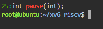</p>

<p align="center"><i>Figure 1.1 – The grep result in user.h</i></p>

user/user.h declares int pause(int); (line 25) and no sleep, so this tree uses the new name. The program user/sleep.c therefore calls pause(). It checks that exactly one argument was given, prints a usage message on standard error otherwise, converts the argument with atoi and makes the system call:

```
#include "kernel/types.h"
#include "user/user.h"

// sleep: pause for a given number of clock ticks.
// In current xv6-riscv the sleep() system call was renamed to pause().

int
main(int argc, char *argv[])
{
  if(argc != 2){
    fprintf(2, "usage: sleep <ticks>\n");
    exit(1);
  }
  pause(atoi(argv[1]));   // system call into the kernel
  exit(0);
}
```

<p align="center">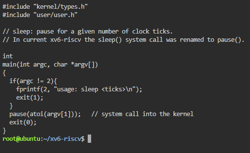</p>

<p align="center"><i>Figure 1.2 – The updated sleep.c</i></p>

The line $U/_sleep\ was added to UPROGS in the Makefile (each line starts with a TAB and ends with a backslash, with nothing after it), then xv6 was rebuilt and started with make qemu.

```
$ sleep 20
$ sleep
usage: sleep <ticks>
```

<p align="center">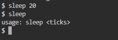</p>

<p align="center"><i>Figure 1.3 – sleep running in xv6, with and without an argument</i></p>

sleep 20 paused the shell for about two seconds (20 ticks of ~100 ms) and returned to the prompt; sleep without an argument printed the usage message.


### 3.2 Part 2 — bash versus the xv6 Shell

Every command was run once in bash, in the empty folder ~/shtest that contains only README (mkdir ~/shtest && cd ~/shtest && touch README), and once at the xv6 $ prompt. The results are compared in Table 1.

Table 1 – The same commands in bash and in the xv6 shell

| Command | Tests | bash | xv6 | Why |
|---|---|---|---|---|
| `echo hello > f ; cat < f` | redirection | hello | hello | Both shells implement < and >. |
| `ls \| grep READ` | pipe | README | README  2 2 2441 | Both have pipes; xv6 ls also prints type, inode and size. |
| `(echo a; echo b) \| wc` | grouping, list | 2  2  4 | 2 2 4 | Both support ( ) and ;. |
| `echo one ; echo two` | sequence | one<br>two | one<br>two | Both run commands in sequence. |
| `echo bg &` | background | [1] 4745<br>bg<br>[1]+ Done echo bg | bg | Both run in the background; only bash has job control and reports the job. |
| `ls *` | globbing | README  f | ls: cannot open * | xv6 does not expand *, so ls gets the literal "*". |
| `echo $HOME` | variables | /root (home dir) | $HOME | xv6 has no variables. |
| `echo "a b"` | quotes | a b | "a b" | xv6 does not remove quotes; it splits at the space. |
| `mkdir d ; cd d ; ls ..` | PATH | README  d  f | exec cd failed<br>(then lists /) | In a list, xv6 runs cd as a program, which does not exist; ls .. ran in /. |
| `arrow up, Tab, Ctrl+R` | history, completion | previous command, completion, history search | nothing useful (raw characters) | xv6 has no history and no completion. |

<p align="center">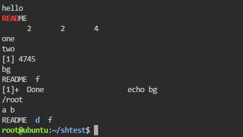</p>

<p align="center"><i>Figure 2.1 – The commands run in bash</i></p>

<p align="center">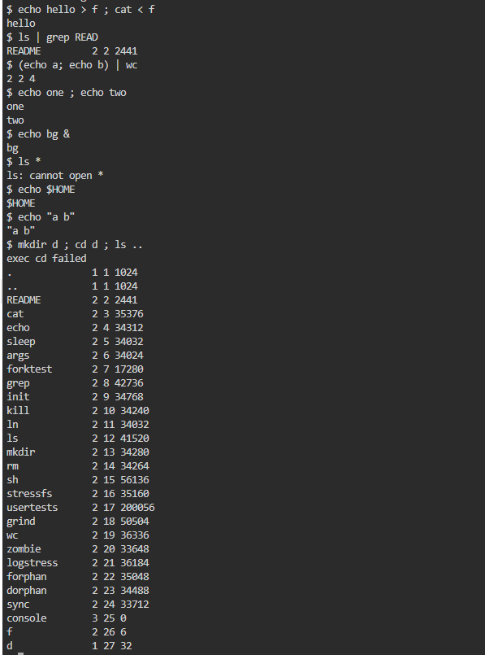</p>

<p align="center"><i>Figure 2.2 – The same commands run in xv6</i></p>

In xv6 the line mkdir d ; cd d ; ls .. printed "exec cd failed": cd is only recognised when it is the whole line (see Part 4), so here the shell tried to run a program called cd. The directory stayed /, and ls .. listed / (the parent of / is / itself). After typing cd d alone, the plain ls command failed with "exec ls failed", while /ls and /ls .. worked:

```
$ cd d
$ ls
exec ls failed
$ /ls ..
(listing of /)
$ /ls
.   ..
```

<p align="center">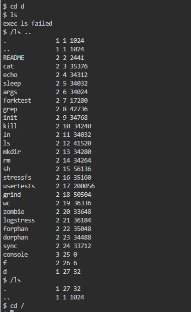</p>

<p align="center"><i>Figure 2.3 – ls failing after cd d, and the working alternative</i></p>

Answers to the questions:

1. Both shells have: running programs, redirection (< > >>), pipes (|), sequences (;), grouping with parentheses and background execution (&), plus the built-in cd. Only bash has: globbing (*, ?, [...]), variables and $ expansion, quote removal, PATH search, command history, Tab completion, reverse search (Ctrl+R), job control (jobs, fg, kill %1), the && and || operators, and scripting (if, for, functions).
2. xv6 has no PATH: the shell calls exec("ls"), and the kernel looks for a file named ls in the current directory. All xv6 programs live in the root directory /, so ls works only while the current directory is /. Inside d the program must be called with its full path: /ls (or /ls .. to list the parent).
3. In daily work I would miss globbing (*) and command history (arrow up) the most. The easiest to add would be a simple PATH rule: if exec of a name without a slash fails, retry it with "/" in front of it. This is a two-line change in runcmd() in sh.c.


### 3.3 Part 3 — Who Expands *? A Program that Prints its argv

The program user/args.c prints the number of arguments and every argument between square brackets, so that spaces at the beginning or end of an argument become visible. It was added to UPROGS as $U/_args\.

```
#include "kernel/types.h"
#include "user/user.h"

int
main(int argc, char *argv[])
{
    printf("argc = %d\n", argc);
    for(int i = 0; i < argc; i++)
        printf("argv[%d] = [%s]\n", i, argv[i]);
    exit(0);
}
```

```
UPROGS=\
    $U/_cat\
    $U/_echo\
    $U/_sleep\
    $U/_args\
    ...
```

<p align="center">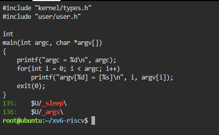</p>

<p align="center"><i>Figure 3.1 – args.c and the UPROGS line</i></p>

The Linux version args_linux.c includes <stdio.h> instead of the two xv6 headers and ends with return 0 instead of exit(0). It was compiled with gcc -o args args_linux.c and run as ./args in a folder that contains some .c files.

```
#include <stdio.h>

int
main(int argc, char *argv[])
{
    printf("argc = %d\n", argc);
    for(int i = 0; i < argc; i++)
        printf("argv[%d] = [%s]\n", i, argv[i]);
    return 0;
}
```

The same lines were run in both shells:

```
args one              two         three
args *.c "x y"
args $HOME
args 'single quoted'
```

<p align="center">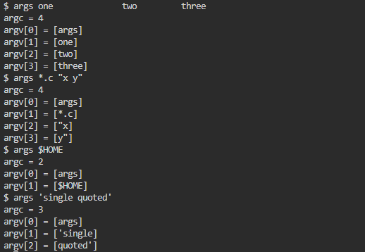</p>

<p align="center"><i>Figure 3.2 – args output in xv6</i></p>

<p align="center">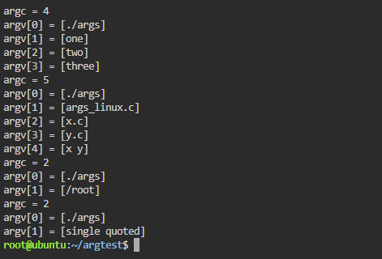</p>

<p align="center"><i>Figure 3.3 – args_linux output in bash</i></p>

Table 2 – Arguments received by the program

| Command line | xv6 (argc, argv[1..]) | bash (argc, argv[1..]) |
|---|---|---|
| `args one    two    three` | 4: [one] [two] [three] | 4: [one] [two] [three] |
| `args *.c "x y"` | 4: [*.c] ["x] [y"] | 5 (with 3 .c files): [args_linux.c] [x.c] [y.c] [x y] |
| `args $HOME` | 2: [$HOME] | 2: [/root] |
| `args 'single quoted'` | 3: ['single] [quoted'] | 2: [single quoted] |

Answers to the questions:

1. In xv6, args *.c "x y" printed argc = 4: argv[1] = [*.c], argv[2] = ["x], argv[3] = [y"]. In bash, ./args *.c "x y" printed argc = 5 in a folder with three .c files: argv[1..3] = the three file names and argv[4] = [x y]. The number of .c files decides the bash count.
2. The shell does it. The program is the same and the kernel only copies the words it receives from exec(); bash replaced *.c with the file names and removed the quotes before calling exec(), while the xv6 shell did neither, so the program received the raw text.
3. The extra spaces disappeared in both shells: the shell splits the line into words at spaces and tabs, and any number of spaces counts as one separator, so the program received just three arguments, one, two and three, without any spaces. To keep the spaces in bash, the text must be quoted.


### 3.4 Part 4 — Reading the Shell

```
wc -l user/sh.c
grep -n "#define" user/sh.c
grep -n "case " user/sh.c
grep -n "cd" user/sh.c | head
```

user/sh.c has 499 lines. The first grep shows the kinds of commands (lines 8–12) and MAXARGS = 10, the maximum number of arguments of a command. The second grep shows four groups of case lines: in runcmd() (lines 75–125), where each kind of command is executed; in gettoken() (lines 284–294), where the special characters | ( ) ; & < > are recognised; in parseredirs() (lines 391–397), which distinguishes <, > and >> (written internally as +); and in nulterminate() (lines 469–493), which prepares each kind of command after parsing.

<p align="center">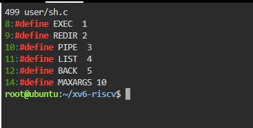</p>

<p align="center"><i>Figure 4.1 – The command kinds defined in sh.c</i></p>

<p align="center">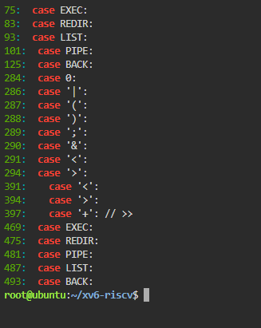</p>

<p align="center"><i>Figure 4.2 – Where each kind is run</i></p>

<p align="center">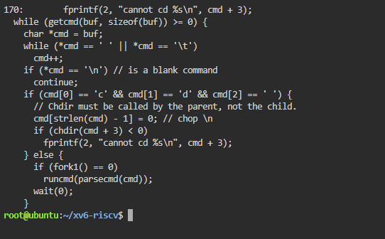</p>

<p align="center"><i>Figure 4.3 – The code that handles cd</i></p>

Answers to the questions:

1. The five kinds of command are: EXEC – a simple command (a program with arguments, no special character); REDIR – redirection, produced by <, > and >> (internally +); PIPE – produced by |; LIST – a sequence, produced by ;; BACK – a background command, produced by &. Parentheses ( ) only group commands into one of these.
2. cd is handled in main() (lines 166–170): if the line starts with "cd ", the shell calls chdir(cmd + 3) itself, in the parent process, and prints "cannot cd ..." on failure. It cannot be a separate program because the current directory belongs to each process: a child that changed its directory would exit and the shell would stay where it was ("Chdir must be called by the parent, not the child", says the comment). This check only looks at the beginning of the line, which is why cd inside mkdir d ; cd d ; ls .. failed in Part 2.
3. There is no code in sh.c that handles * or $. The tokenizer gettoken() only knows whitespace (" \t\r\n\v") and the symbols "<|>&;()"; every other character, including *, $ and quotes, is copied into the word unchanged. This explains Part 2 and Part 3: in xv6 ls * received the literal *, echo $HOME printed $HOME, and quotes were not removed.


## CONCLUSION

This laboratory work compared a minimal shell with a full one. The xv6 shell, in under 500 lines, already does everything a shell must do: it reads a line, parses it into five kinds of commands and runs them with fork, exec, wait, pipe, dup and open; it supports redirection, pipes, sequences, grouping and background commands, and runs cd itself because only the parent process can change its own directory.

Everything else that makes bash comfortable is added on top: variables, globbing, quote removal, PATH search, history, completion and job control. The args program showed this directly: the same program received 4 arguments in xv6 and 5 in bash for the same line, which proves that it is the shell, not the program or the kernel, that turns *.c into file names and removes quotes. The sleep program from Lab 2 was checked against the current xv6, where the system call is named pause().


## REFERENCES

1. Cox, R., Kaashoek, F., Morris, R. xv6: a simple, Unix-like teaching operating system (RISC-V version), chapter 1 "Operating system interfaces". MIT. Available at: https://pdos.csail.mit.edu/6.1810/

2. MIT PDOS. xv6-riscv source code repository (user/sh.c). Available at: https://github.com/mit-pdos/xv6-riscv

3. GNU Bash Reference Manual. Free Software Foundation. Available at: https://www.gnu.org/software/bash/manual/

4. Kernighan, B. W., Ritchie, D. M. The C Programming Language. 2nd ed. Prentice Hall, 1988.
