# Report on laboratory works no. 5–6

**Course:** Operating Systems  
**Topic:** The File System: Linux and xv6  
**Done by:** st. gr. FAF-243, Buliga Vladislav  
**Checked by:** Reițman Patricia, asist. univ.  
Chișinău, 2026

---

## 1 AIM OF THE WORK


### 1.1 Purpose of the laboratory works

Laboratory works 5 and 6 study the file system from two sides. Lab 5 checks, on a real Linux system, the ideas presented in the lecture: the directory tree and the file types, inodes behind the file names, hard and symbolic links, permissions, and the disks underneath. Lab 6 looks at the same ideas inside the small xv6 file system, which implements inodes, directories as tables and hard links in a few hundred readable lines: it reads what xv6 shows, adds a stat program, measures the limits written in kernel/fs.h and implements find, which walks the directory tree recursively.


### 1.2 Problem statement

**Lab 5 – The File System with Your Own Hands (Linux):**

- explore the root of the directory tree and identify the types of files from ls -l and file;
- examine an inode with stat, create hard and symbolic links, count the links of directories, and compare file size with disk space;
- experiment with file and directory permissions, the umask and the special bits setuid and sticky;
- examine disks, partitions and mounted file systems, and read hardware and process information from /proc;
- optional: two stretch tasks (magic numbers, and deleting a file that is still open).

**Lab 6 – Inside the xv6 File System:**

- decode the output of ls in xv6 using kernel/stat.h and explain the size of an empty directory;
- write user/mystat.c and use it to watch hard links at work; find where sys_unlink decrements the link count and read struct dinode;
- measure the limits of the file system: the maximum name length, the maximum file size and the disk layout;
- write user/find.c, which prints every path under a directory whose last component has a given name; optional: print inode numbers.


## 2 THEORETICAL BACKGROUND


### 2.1 The Directory Tree and File Types

Linux presents all files in a single tree that starts at the root directory /. The first character of the ls -l output gives the type of each entry: - regular file, d directory, l symbolic link, c character device, b block device, p named pipe and s socket. Character devices (terminals, /dev/null) transfer data as a stream of bytes, while block devices (disks and partitions) transfer it in fixed-size blocks.


### 2.2 Inodes and Directory Entries

Every file is described by an inode, a structure on the disk that holds its type, permissions, owner, size, timestamps, the number of links and the addresses of its data blocks. The name of the file is not stored in the inode: a directory is simply a table of entries (name → inode number). The same inode can therefore have several names.


### 2.3 Hard and Symbolic Links

A hard link (ln) is an additional directory entry that points to the same inode; the link count in the inode is increased. The file data is freed only when the link count reaches zero and no process keeps the file open. A symbolic link (ln -s) is a separate small file with its own inode whose content is a path to another file; if the target is removed, the symbolic link remains but points to nothing.


### 2.4 Permissions, umask and Special Bits

Each file has three groups of permissions, for the owner (u), the group (g) and others (o), each made of r (read, 4), w (write, 2) and x (execute, 1). On a directory, r allows listing the names, w allows creating and deleting entries and x allows entering the directory and accessing files inside it. The umask removes bits from the default permissions of new files (666) and directories (777). The special bits are setuid (s in the owner's x position: the program runs with the rights of the file's owner), setgid, and the sticky bit (t on a directory: only the owner of a file may delete or rename it).


### 2.5 Disks, Mounting and /proc

A physical disk (for example /dev/sda) is divided into partitions (/dev/sda1, /dev/sda2), each holding a file system such as ext4. A file system becomes part of the tree when it is mounted on a directory. /proc is a virtual file system generated by the kernel: its files do not exist on the disk, but reading them returns live information about the hardware and the processes, which illustrates the UNIX idea that "everything is a file".


### 2.6 The xv6 File System

xv6 uses the same ideas as ext4 in a much simpler form. The disk is an array of 1024-byte blocks: a boot block, a superblock, a log (journal) used to make operations crash-safe, a table of inodes, a bitmap of free blocks, and finally the data blocks. An on-disk inode (struct dinode in kernel/fs.h) stores only the type, the device numbers, the link count, the size and the addresses of the data blocks: 12 direct block addresses and one indirect block that holds more addresses. A directory is a file containing fixed-size entries (struct dirent): a 2-byte inode number and a name of at most DIRSIZ = 14 characters. xv6 has hard links but no symbolic links, no owners and no permissions.


### 2.7 Walking a Directory Tree

A program reads a directory like a file: it opens it with open() and reads struct dirent records one by one with read(). An entry with inum = 0 is a free slot. For each entry the program can build the full path and call stat() to learn whether it is itself a directory. A recursive program such as find must skip the entries "." and "..", which point to the directory itself and to its parent, otherwise it would loop forever, and it must close every directory it opens, because a process may have only a limited number of open files (16 in xv6).


## 3 LABORATORY WORK 5 — THE FILE SYSTEM WITH YOUR OWN HANDS (LINUX)

The work was done on an Ubuntu 24.04 virtual machine running in Parallels Desktop on an Apple computer, as the normal user parallels, not as root, because root ignores most permission checks and the experiments would give misleading results. An attempt to create another user with useradd confirmed this: it failed with "Permission denied" and "cannot lock /etc/passwd", since only root may change the user database. All experiments were done in the folder ~/os-lab5.


### 3.1 Part 1 — The Tree and the File Types

```
whoami
ls /
ls -ld /etc /etc/passwd /bin /dev/null /tmp
ls -l /dev | head
file /usr/bin/ls /etc/passwd /bin
du -sh /var/log 2>/dev/null ; du -sh /usr 2>/dev/null
```

<p align="center">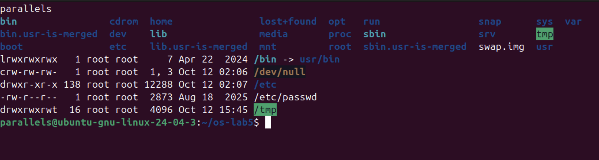</p>

<p align="center"><i>Figure 5.1.1 – The root directory and the types of five paths</i></p>

<p align="center">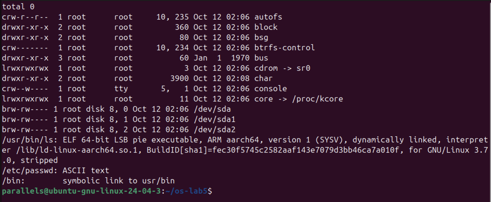</p>

<p align="center"><i>Figure 5.1.2 – Device files in /dev and the output of file</i></p>

<p align="center">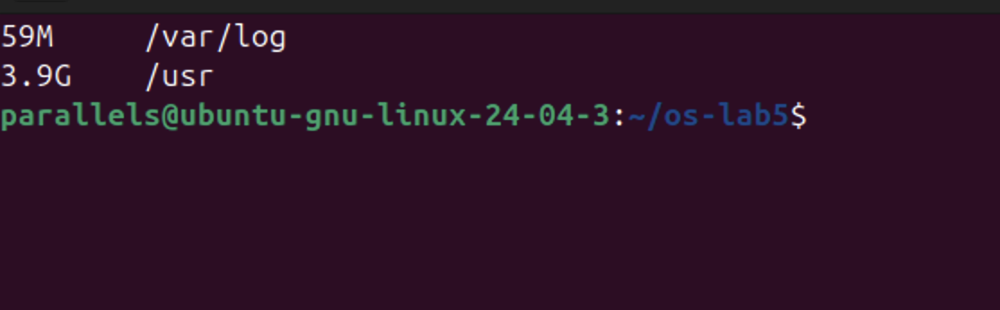</p>

<p align="center"><i>Figure 5.1.3 – Disk space used by /var/log and /usr</i></p>

Answers to the questions:

1. From the first letter of ls -l: /etc – d (directory), /etc/passwd – - (regular file), /bin – l (symbolic link), /dev/null – c (character device), /tmp – d (directory, with the sticky bit t at the end of its permissions).
2. /bin is not a real directory but a symbolic link to usr/bin (lrwxrwxrwx ... /bin -> usr/bin); file /bin confirms "symbolic link to usr/bin". On modern Ubuntu /bin, /lib and /sbin are merged into /usr.
3. Character devices: /dev/null (crw-rw-rw-, major/minor 1, 3), /dev/console and /dev/autofs. Block devices: /dev/sda (brw-rw----, 8, 0), the virtual disk of the VM, and its partitions /dev/sda1 and /dev/sda2. The command file also showed that /usr/bin/ls is an "ELF 64-bit ... ARM aarch64" executable, because the VM runs on an Apple processor, and /etc/passwd is ASCII text.
4. /usr is much bigger: 3.9 GB compared with 59 MB for /var/log, about 68 times more, since /usr contains all installed programs and libraries while /var/log only holds log files.


### 3.2 Part 2 — Inodes and Links

```
echo hello > notes.txt
stat notes.txt
ls -li notes.txt
```

<p align="center">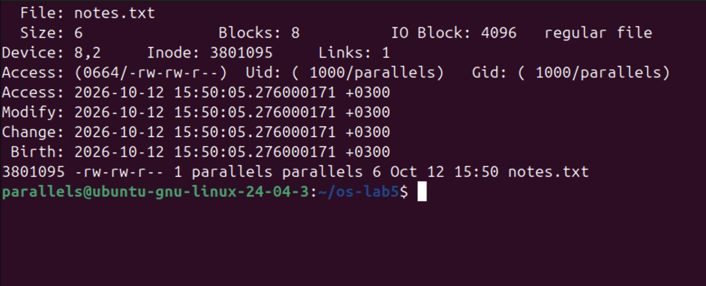</p>

<p align="center"><i>Figure 5.2.1 – The inode of notes.txt shown by stat and ls -li</i></p>

```
ln notes.txt hard.txt
ls -li notes.txt hard.txt
rm notes.txt
cat hard.txt ; ls -li hard.txt
```

<p align="center">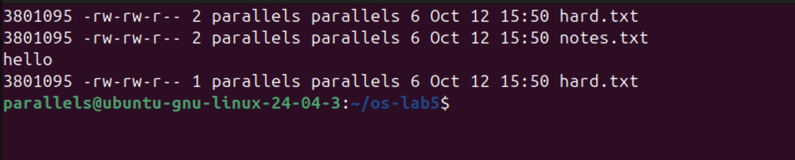</p>

<p align="center"><i>Figure 5.2.2 – A hard link, and removing the "original" name</i></p>

```
ln -s hard.txt soft.txt
ls -li hard.txt soft.txt
cat soft.txt
rm hard.txt
cat soft.txt ; ls -l soft.txt
```

<p align="center">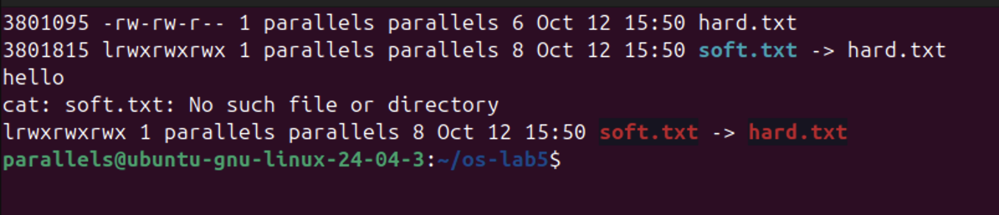</p>

<p align="center"><i>Figure 5.2.3 – A symbolic link, and removing its target</i></p>

```
mkdir d ; ls -ld d
mkdir d/x d/y ; ls -ld d
```

<p align="center">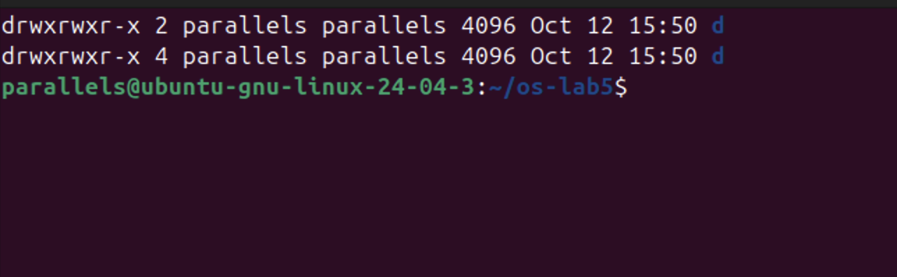</p>

<p align="center"><i>Figure 5.2.4 – The link count of a directory</i></p>

```
echo x > one.txt ; ls -l one.txt ; du -h one.txt
truncate -s 1G big.img ; ls -lh big.img ; du -h big.img
rm big.img
```

<p align="center">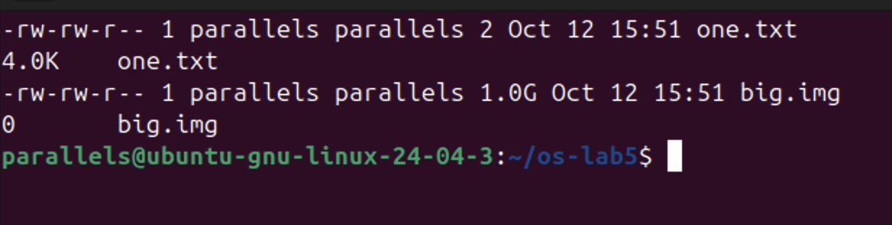</p>

<p align="center"><i>Figure 5.2.5 – File size compared with disk space used</i></p>

Answers to the questions:

1. In the stat output the inode number is "Inode: 3801095" (also the first column of ls -li), and the number of names of the file is "Links: 1". stat also shows Size: 6 (the 6 bytes of "hello" plus the newline), Blocks: 8 (eight 512-byte sectors = 4 KB), the permissions 0664/-rw-rw-r--, the owner parallels (uid 1000) and the access, modify, change and birth times.
2. ln created a second name, hard.txt, for the same inode 3801095, and the link count became 2. rm notes.txt removed only the name notes.txt from the directory and decreased the link count to 1; the inode and its data were untouched, so hard.txt still printed "hello". rm removes a directory entry (it calls unlink); the file itself is freed only when its link count reaches 0 and no process has it open.
3. soft.txt is a separate file with its own inode (3801815) whose content is the path "hard.txt". After rm hard.txt that path leads nowhere (a "dangling" link, shown in red), so cat soft.txt failed with "No such file or directory" although soft.txt itself still exists. Its size is exactly 8 bytes because it stores the 8 characters of the name "hard.txt".
4. The new directory d has 2 links: its entry "d" in the parent directory ~/os-lab5, and the entry "." inside d itself. After creating d/x and d/y it has 4 links, because each subdirectory contains an entry ".." that points back to d (2 + 2 = 4). In general, the link count of a directory is 2 plus the number of its subdirectories.
5. Disk space is allocated in whole blocks of 4 KB (IO Block: 4096 in stat), so the 2-byte file one.txt occupies one block, 4.0K. big.img was created with truncate, which only sets the size to 1 GB without writing any data; such a sparse file has no data blocks allocated, so du shows 0, while ls shows its logical size of 1.0G. Blocks would be allocated only when real data is written.


### 3.3 Part 3 — Permissions

```
echo secret > s.txt
chmod 600 s.txt ; ls -l s.txt
chmod 000 s.txt ; cat s.txt
chmod u+r s.txt ; cat s.txt
```

<p align="center">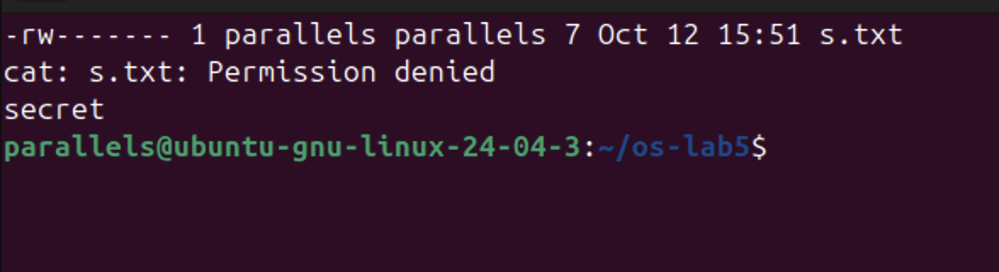</p>

<p align="center"><i>Figure 5.3.1 – Permissions of a file: 600, 000 and u+r</i></p>

```
umask ; touch new.txt ; mkdir newdir ; ls -ld new.txt newdir
```

<p align="center">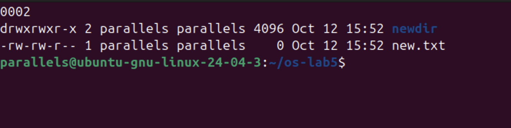</p>

<p align="center"><i>Figure 5.3.2 – The umask and the permissions of new files and directories</i></p>

```
mkdir box ; echo hi > box/f
chmod u=r,go= box ; ls box ; cat box/f     # read only
chmod u=x,go= box ; ls box ; cat box/f     # execute only
chmod 755 box
```

<p align="center">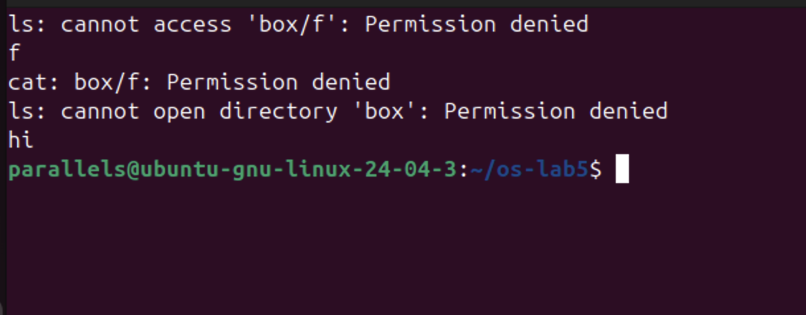</p>

<p align="center"><i>Figure 5.3.3 – The box experiment: r and x on a directory</i></p>

```
ls -l /usr/bin/passwd ; ls -ld /tmp
cat /etc/shadow
ls -l /etc/shadow
```

<p align="center">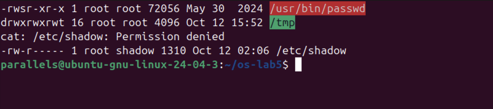</p>

<p align="center"><i>Figure 5.3.4 – The setuid bit of passwd, the sticky bit of /tmp and /etc/shadow</i></p>

Table 1 – Common permission modes

| Octal | rwx string | Typical use |
|---|---|---|
| 600 | rw------- | private files: SSH private keys, s.txt in this lab |
| 644 | rw-r--r-- | ordinary files readable by everyone: /etc/passwd, documents |
| 755 | rwxr-xr-x | programs and public directories: /usr/bin/ls, box at the end |
| 700 | rwx------ | private directories and scripts: ~/.ssh, a personal script |

Answers to the questions:

1. 600 = rw------- (private files such as an SSH key), 644 = rw-r--r-- (normal files everyone may read, e.g. /etc/passwd), 755 = rwxr-xr-x (programs and public directories), 700 = rwx------ (private directories such as ~/.ssh). See Table 1.
2. With chmod 000, cat s.txt failed with "Permission denied" even though parallels owns the file. The kernel decides access only from the permission bits of the owner class; ownership does not give access by itself, it only gives the right to change the permissions. That is why chmod u+r worked and cat then printed "secret". Only root bypasses these checks.
3. The umask is 0002. New files are created with 666 and new directories with 777, and the umask removes the w bit for others: new.txt got 666 − 002 = 664 (-rw-rw-r--) and newdir got 777 − 002 = 775 (drwxrwxr-x).
4. With only r on box, ls could read the list of names and printed f, but could not get its details ("cannot access 'box/f'"), and cat box/f was denied: r allows reading the directory listing but not using the entries. With only x, ls failed ("cannot open directory") but cat box/f printed "hi": x allows entering the directory and reaching a file whose name is already known, but not listing the names.
5. The s in -rwsr-xr-x of /usr/bin/passwd is the setuid bit: whoever runs passwd, the program runs with the rights of its owner, root. passwd needs it because it must write the new password hash into /etc/shadow, which belongs to root and is not even readable by normal users (-rw-r----- root shadow; cat /etc/shadow gave "Permission denied"). The t in drwxrwxrwt of /tmp is the sticky bit: everyone may create files in /tmp, but each user may delete or rename only his own files.


### 3.4 Part 4 — Disks and the Kernel as Files

```
lsblk
df -h
mount | grep " / "
```

<p align="center">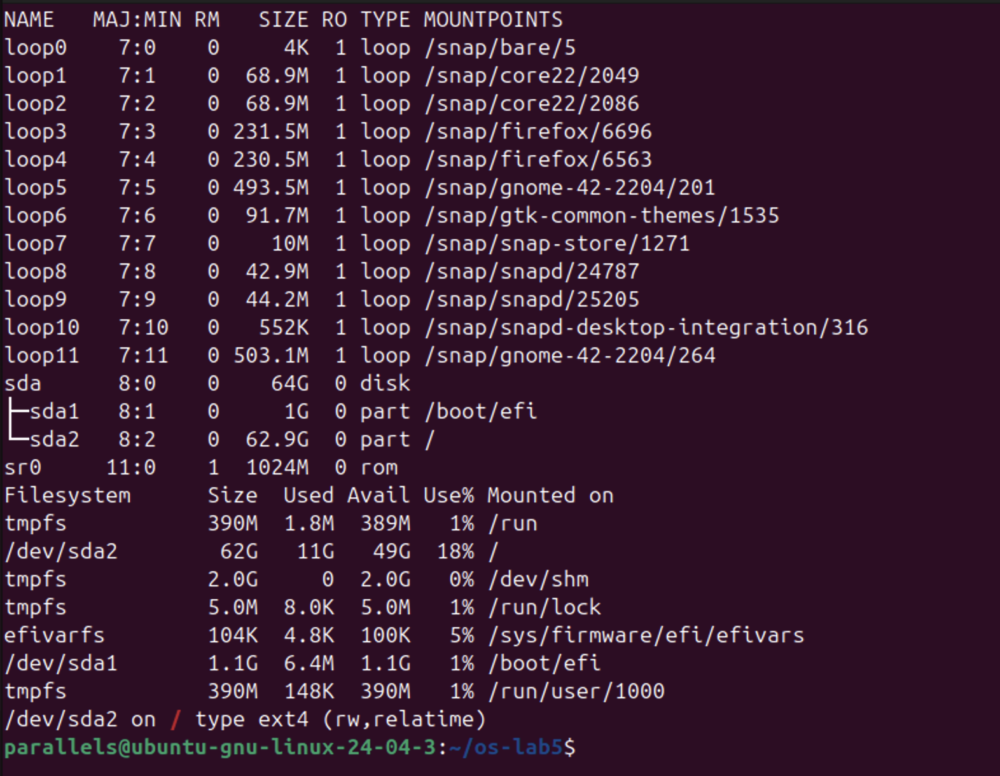</p>

<p align="center"><i>Figure 5.4.1 – Disks, partitions and mounted file systems</i></p>

```
grep -c processor /proc/cpuinfo
head -3 /proc/meminfo
head -5 /proc/self/status
ls -l /proc/self/fd
```

<p align="center">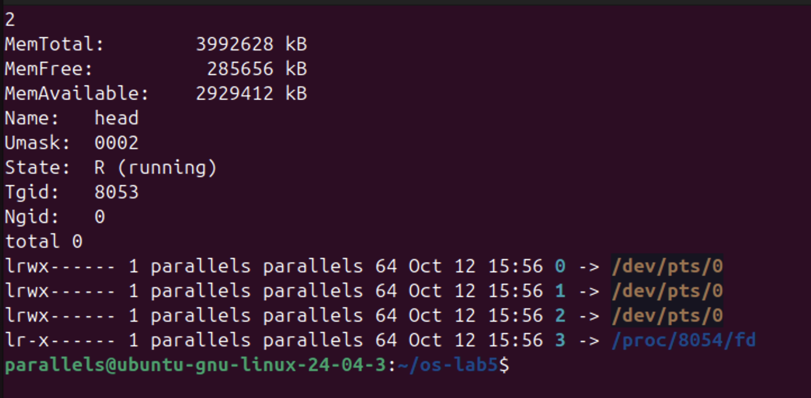</p>

<p align="center"><i>Figure 5.4.2 – Information read from /proc</i></p>

The structure of the disk, drawn from the output of lsblk:

```
sda   64G  disk                     (virtual disk of the VM)
├── sda1   1G  part  → /boot/efi    vfat, EFI boot partition
└── sda2  62.9G part  → /            ext4, root file system
sr0   1024M  rom                    (virtual CD-ROM)
loop0..loop11  read-only snap packages mounted under /snap
```

Answers to the questions:

1. The VM has one virtual disk, sda, of 64 GB, with two partitions: sda1 (1 GB), mounted at /boot/efi (the EFI boot partition), and sda2 (62.9 GB), mounted at / with the file system type ext4 (mount shows "/dev/sda2 on / type ext4 (rw,relatime)"). There is also a virtual CD-ROM sr0 and twelve loop devices: snap packages stored as read-only image files and mounted under /snap.
2. The root file system /dev/sda2 has 62 GB in total, 11 GB used and 49 GB available: it is 18% full.
3. grep -c processor /proc/cpuinfo printed 2, so the VM has 2 CPU cores; /proc/meminfo shows MemTotal: 3992628 kB, about 3.8 GB (4 GB) of RAM, of which 2929412 kB (about 2.8 GB) is available.
4. /proc/self/status showed "Name: head". /proc/self is a link that always points to the process that is reading it; the file was read by the program head (in head -5 /proc/self/status), so it showed the status of head itself, with State: R (running). For the same reason ls -l /proc/self/fd listed the open files of ls: 0, 1 and 2 (standard input, output and error) connected to the terminal /dev/pts/0, and 3, the directory ls was reading.


### 3.5 Stretch Tasks

**(a) Magic numbers**

```
gzip -c /etc/passwd > notes.txt ; file notes.txt ; xxd notes.txt | head -1
```

<p align="center">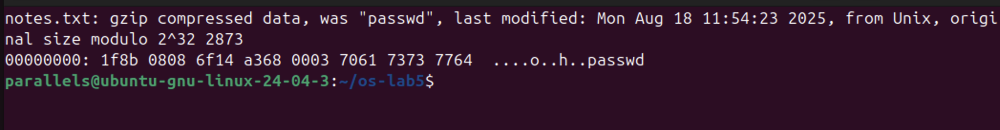</p>

<p align="center"><i>Figure 5.5.1 – A gzip file named notes.txt, recognised by its first bytes</i></p>

Although the file is named notes.txt, file reported "gzip compressed data, was "passwd"". The name and extension do not matter: file reads the first bytes of the content, the magic number. Every gzip file starts with the two bytes 1f 8b; the next byte, 08, is the compression method (deflate). The original name "passwd" is also stored in the header, as the xxd dump shows.

**(c) Deleting a file that is still open**

```
head -c 50M /dev/zero > bigfile
df -h ~ | tail -1
exec 3< bigfile ; rm bigfile
ls -l /proc/$$/fd
df -h ~ | tail -1
exec 3<&-
df -h ~ | tail -1
```

<p align="center">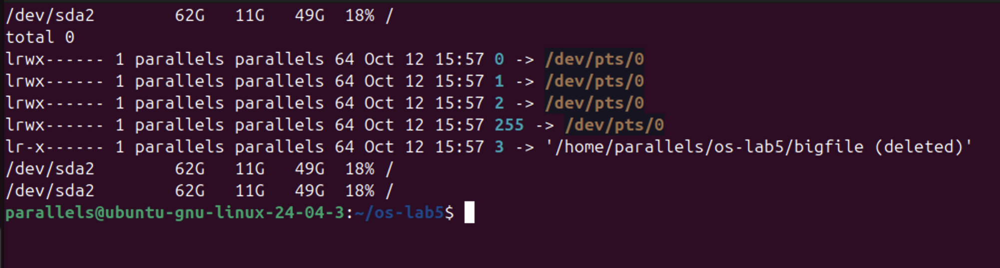</p>

<p align="center"><i>Figure 5.5.2 – A deleted file that is still open by the shell</i></p>

After rm bigfile, the shell still held the file open on descriptor 3, and /proc/$$/fd showed 3 -> '/home/parallels/os-lab5/bigfile (deleted)'. rm removed the only name, so the link count became 0, but the inode and its 50 MB of data are kept as long as a process has the file open. The space is really freed only when the last descriptor is closed, here with exec 3<&-. (The change of 50 MB is too small to appear in df -h, which rounds to whole gigabytes on this 62 GB disk.) This is also why a full disk is sometimes not freed after deleting a large log file: a running program still has it open.


## 4 LABORATORY WORK 6 — INSIDE THE xv6 FILE SYSTEM

Lab 6 was done on the same Ubuntu virtual machine. The RISC-V cross-compiler and QEMU were installed and xv6 was cloned into ~/xv6-riscv. Every new program is a file user/NAME.c plus a line $U/_NAME\ in UPROGS in the Makefile; two programs were added, mystat and find.

```
sudo apt install -y git build-essential qemu-system-misc gcc-riscv64-linux-gnu binutils-riscv64-linux-gnu
git clone https://github.com/mit-pdos/xv6-riscv ~/xv6-riscv
cd ~/xv6-riscv
```


### 4.1 Part 1 — Reading What xv6 Shows

```
cat kernel/stat.h
```

<p align="center">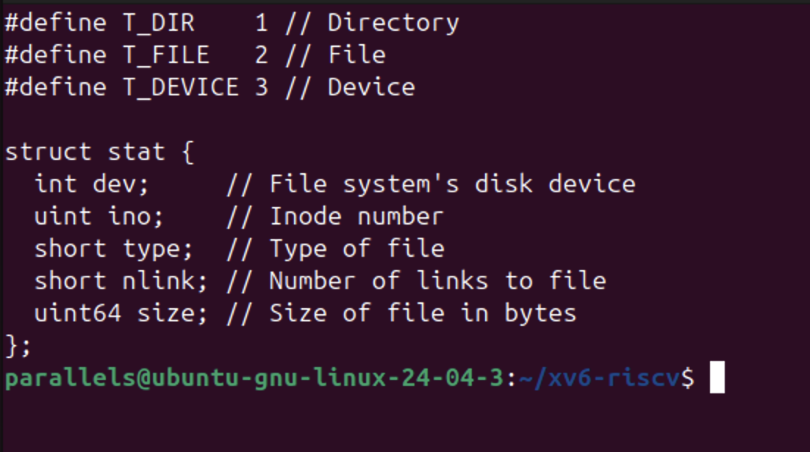</p>

<p align="center"><i>Figure 6.1.1 – The file types and struct stat in kernel/stat.h</i></p>

```
make clean ; make qemu
$ ls
$ mkdir a
$ ls a
```

<p align="center">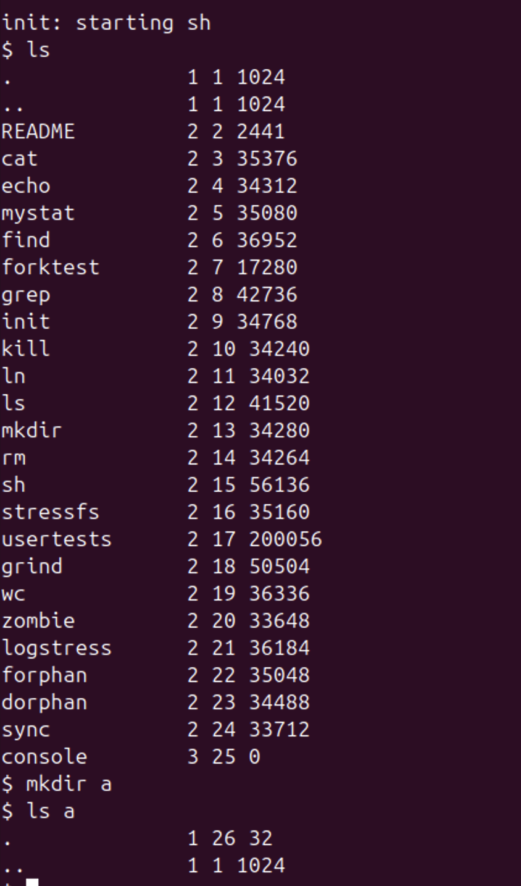</p>

<p align="center"><i>Figure 6.1.2 – ls in xv6, and the contents of a new directory</i></p>

Each line printed by xv6 ls is: name, type, inode number and size in bytes.

Answers to the questions:

1. kernel/stat.h defines T_DIR = 1 (directory), T_FILE = 2 (regular file) and T_DEVICE = 3 (device). In the listing, . and .. have type 1, README and all programs type 2, and console type 3.
2. The root directory has inode number 1 (ROOTINO). In the root, . and .. are the same (both inode 1) because the root has no parent: its ".." entry points to itself, just as cd .. in / stays in /.
3. One directory entry (struct dirent) takes 16 bytes: a 2-byte inode number (ushort inum) plus a 14-byte name (DIRSIZ = 14). The empty directory a has size 32 = 2 × 16, so it contains exactly two entries: "." (inode 26, a itself) and ".." (inode 1, the root).


### 4.2 Part 2 — The mystat Program

mystat calls the stat() library function for every argument; stat() fills a struct stat (dev, ino, type, nlink, size). The helper typename() converts the numeric type into a word with a switch on T_DIR, T_FILE and T_DEVICE. If stat() fails, an error is printed on file descriptor 2 and the program continues with the next argument.

Source code (user/mystat.c):

```
#include "kernel/types.h"
#include "kernel/stat.h"
#include "user/user.h"

// mystat: print type, inode number, link count and size of each argument.

char *
typename(int t)
{
  switch(t){
  case T_DIR:    return "directory";
  case T_FILE:   return "file";
  case T_DEVICE: return "device";
  }
  return "?";
}

int
main(int argc, char *argv[])
{
  struct stat st;

  if(argc < 2){
    fprintf(2, "usage: mystat <path>...\n");
    exit(1);
  }
  for(int i = 1; i < argc; i++){
    if(stat(argv[i], &st) < 0){
      fprintf(2, "mystat: cannot stat %s\n", argv[i]);
      continue;
    }
    printf("%s: %s, inode %d, links %d, size %d bytes\n",
           argv[i], typename(st.type), st.ino, st.nlink, (int)st.size);
  }
  exit(0);
}
```

```
$ mystat README . console
$ ln README r2
$ mystat README r2
$ rm README
$ mystat r2
$ cat r2 | wc
```

<p align="center">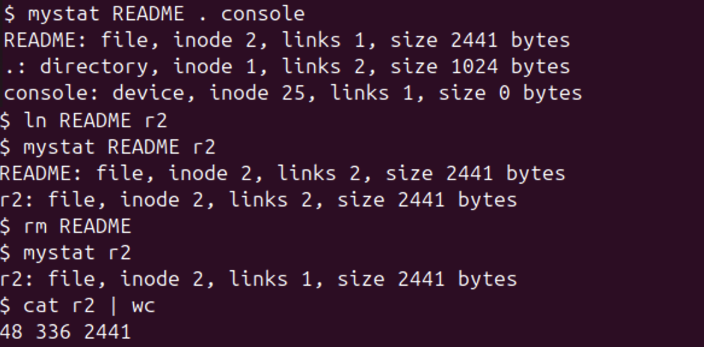</p>

<p align="center"><i>Figure 6.2.1 – mystat output before and after ln and rm</i></p>

Note: on this ARM virtual machine xv6 sometimes printed "exec <program> failed" for a command that is correct and worked when typed again; this is a transient problem of running the RISC-V emulator, not of the programs. Figure 6.2.1 is therefore assembled from two runs on a freshly built disk (make clean ; make qemu): the first lines from one run and the ln/rm sequence from the other; the outputs are identical.

```
grep -n "nlink--" kernel/sysfile.c
sed -n '/struct dinode/,/};/p' kernel/fs.h
```

<p align="center">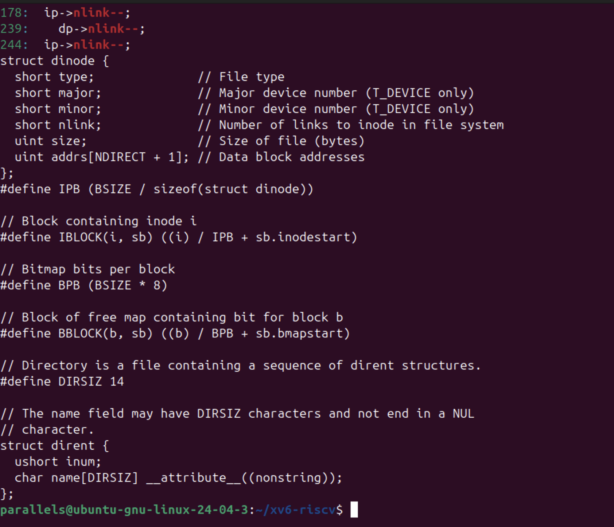</p>

<p align="center"><i>Figure 6.2.2 – The link count decrement in sys_unlink and struct dinode</i></p>

Answers to the questions:

1. After ln README r2, both names show the same file: inode 2, links 2, size 2441 bytes. After rm README, r2 still shows inode 2 and size 2441, but links 1, and cat r2 | wc still prints 48 336 2441: the content was not touched. Only the number of names (nlink) changed; the inode, its number, size and data stayed the same.
2. In kernel/sysfile.c, sys_unlink() clears the directory entry and then decrements the link count with ip->nlink--; (line 244), followed by iupdate(ip) to write the inode back to disk. The data blocks are not freed there: they are freed later in iput() (kernel/fs.c), which calls itrunc() to free all the blocks when the link count is 0 and the last in-memory reference to the inode is released, i.e. when no process has the file open any more.
3. struct dinode has only six fields: type (file, directory or device), major and minor (device numbers, for T_DEVICE), nlink (number of links), size (in bytes) and addrs[NDIRECT + 1] (12 direct block addresses and one indirect block). There is no owner, no group, no permission bits and no timestamps, which is why xv6 has no permissions; and since the type can only be a directory, a file or a device, there are no symbolic links either.


### 4.3 Part 3 — Measuring the Limits

```
grep -n "define BSIZE\|define NDIRECT\|define NINDIRECT\|define DIRSIZ" kernel/fs.h
make clean ; make fs.img 2>&1 | grep nmeta
```

<p align="center">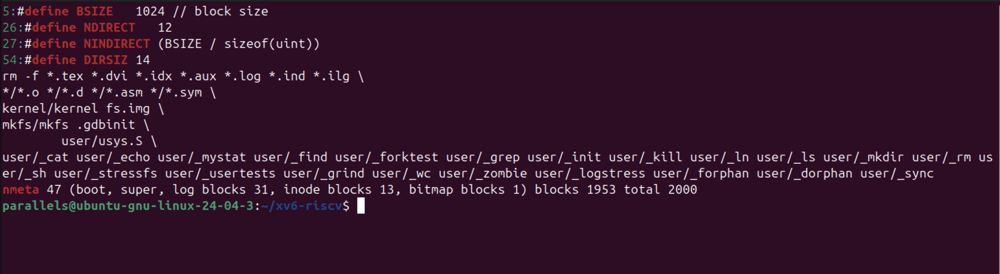</p>

<p align="center"><i>Figure 6.3.1 – The constants in kernel/fs.h and the disk layout printed by mkfs</i></p>

```
$ mkdir averyveryverylongname
$ ls
```

<p align="center">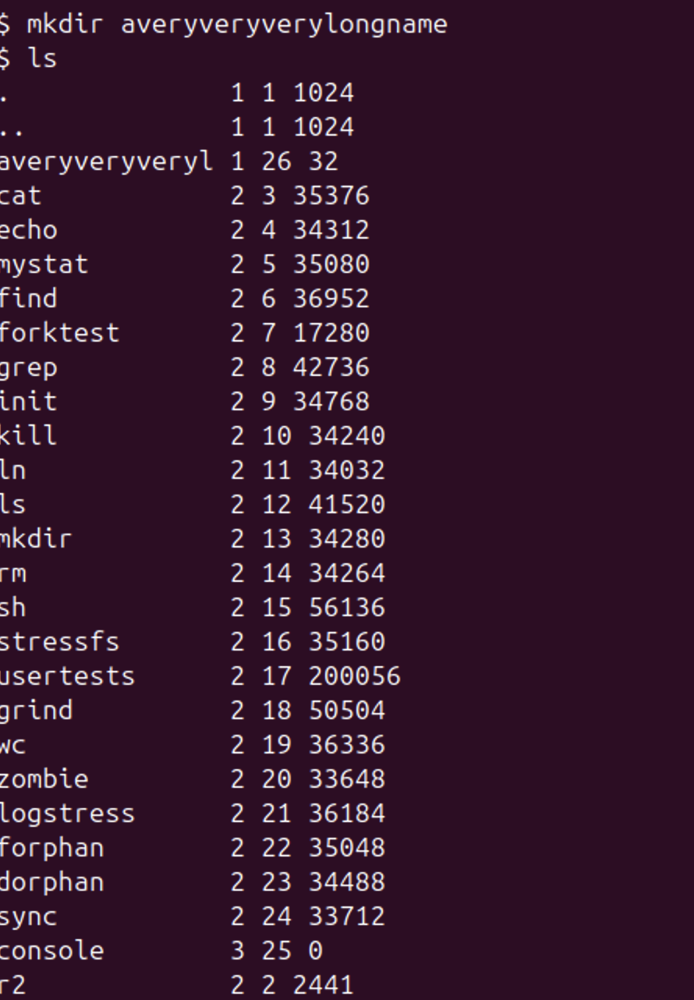</p>

<p align="center"><i>Figure 6.3.2 – A directory with a name longer than 14 characters</i></p>

Answers to the questions:

1. ls shows the directory as "averyveryveryl": only the first 14 characters of averyveryverylongname were kept. The constant DIRSIZ = 14 in kernel/fs.h limits the name field of a directory entry to 14 bytes, and longer names are cut.
2. BSIZE = 1024 bytes, NDIRECT = 12, and NINDIRECT = BSIZE / sizeof(uint) = 1024 / 4 = 256 block numbers in the indirect block. The largest file has MAXFILE = NDIRECT + NINDIRECT = 12 + 256 = 268 blocks, i.e. 268 × 1024 = 274 432 bytes = 268 KB.
3. The nmeta line was: "nmeta 47 (boot, super, log blocks 31, inode blocks 13, bitmap blocks 1) blocks 1953 total 2000". The whole disk has 2000 blocks of 1 KB (about 2 MB). 47 blocks are metadata: 1 boot block, 1 superblock, 31 log blocks, 13 inode blocks (16 inodes of 64 bytes fit in one block, so 13 blocks hold the 200 inodes) and 1 bitmap block; the remaining 1953 blocks are for data.


### 4.4 Part 4 — The find Program

find was written starting from user/ls.c. The recursive function find(path, name) opens the directory, copies "path/" into a buffer and reads the entries one by one. It skips free slots (inum == 0) and the entries "." and "..", appends each name to the buffer to build the full path, and calls stat() on it. If the name equals the one searched for (strcmp), the path is printed; if the entry is a directory, find calls itself on it. Every directory is closed before returning, because xv6 allows only 16 open files per process and a deep tree would otherwise run out of descriptors. The optional third argument -n also prints the inode number.

Source code (user/find.c):

```
#include "kernel/types.h"
#include "kernel/stat.h"
#include "user/user.h"
#include "kernel/fs.h"
#include "kernel/fcntl.h"

// find <dir> <name> [-n]
// Prints every path under <dir> whose last component is <name>.
// With -n, the inode number is printed next to each path.

int show_inum = 0;

void
find(char *path, char *name)
{
  char buf[512], *p;
  int fd;
  struct dirent de;
  struct stat st;

  if((fd = open(path, O_RDONLY)) < 0){
    fprintf(2, "find: cannot open %s\n", path);
    return;
  }
  if(fstat(fd, &st) < 0 || st.type != T_DIR){
    fprintf(2, "find: %s is not a directory\n", path);
    close(fd);
    return;
  }
  if(strlen(path) + 1 + DIRSIZ + 1 > sizeof buf){
    fprintf(2, "find: path too long\n");
    close(fd);
    return;
  }

  // buf = "path/"; each entry name is copied after the slash
  strcpy(buf, path);
  p = buf + strlen(buf);
  *p++ = '/';

  while(read(fd, &de, sizeof(de)) == sizeof(de)){
    if(de.inum == 0)                                   // free slot
      continue;
    memmove(p, de.name, DIRSIZ);
    p[DIRSIZ] = 0;
    if(strcmp(p, ".") == 0 || strcmp(p, "..") == 0)   // never recurse into . and ..
      continue;
    if(stat(buf, &st) < 0){
      fprintf(2, "find: cannot stat %s\n", buf);
      continue;
    }
    if(strcmp(p, name) == 0){                          // last component matches
      if(show_inum)
        printf("%s %d\n", buf, st.ino);
      else
        printf("%s\n", buf);
    }
    if(st.type == T_DIR)                               // go deeper
      find(buf, name);
  }
  close(fd);                                           // max 16 open files per process
}

int
main(int argc, char *argv[])
{
  if(argc < 3 || argc > 4 || (argc == 4 && strcmp(argv[3], "-n") != 0)){
    fprintf(2, "usage: find <dir> <name> [-n]\n");
    exit(1);
  }
  show_inum = (argc == 4);
  find(argv[1], argv[2]);
  exit(0);
}
```

```
make clean ; make qemu
$ mkdir a
$ mkdir a/b
$ echo x > a/b/r2
$ echo y > a/r2
$ ln cat r2
$ find . r2
$ find a b
```

<p align="center">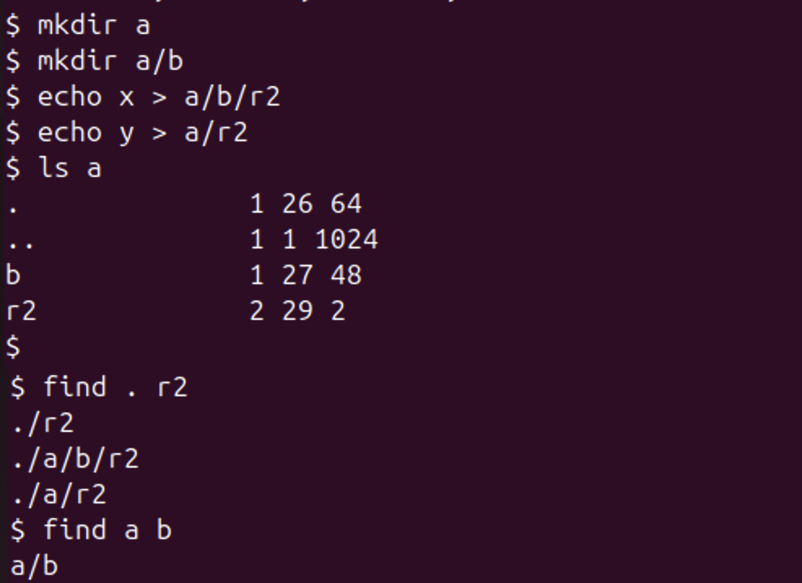</p>

<p align="center"><i>Figure 6.4.1 – Testing find on a fresh disk</i></p>

find . r2 printed the three paths ./r2, ./a/b/r2 and ./a/r2, and find a b printed a/b, as expected (the order follows the order of the entries in each directory). The listing of a also confirms Part 1: a now has four entries (., .., b and r2), so its size grew to 4 × 16 = 64 bytes, and a/b, with three entries, has 48 bytes.

**Stretch: printing inode numbers**

```
$ find . r2 -n
$ mystat cat
```

<p align="center">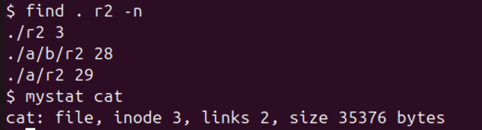</p>

<p align="center"><i>Figure 6.4.2 – find with inode numbers, compared with cat</i></p>

With -n, ./r2 has inode 3, the same as cat (mystat cat shows inode 3, links 2), so ./r2 and cat are the same file: ln cat r2 only added a second name. The other two, ./a/r2 and ./a/b/r2, have their own inodes (29 and 28): they are different files that only happen to have the same name.


## CONCLUSION

This laboratory work confirmed the main ideas of file systems on a real Ubuntu system. A file is an inode, while names are only directory entries that point to it: a hard link added a second name to inode 3801095, and rm removed a name, not the file, which disappears only when its link count is zero and nobody has it open, as the stretch task with the deleted open file showed. A symbolic link, by contrast, is a small separate file containing a path, which breaks when its target is removed. Disk space is allocated in 4 KB blocks, so a 2-byte file takes 4 KB and a sparse 1 GB file takes nothing.

Permissions are enforced by the kernel from the rwx bits alone: even the owner could not read a file with mode 000, the umask 0002 explained the modes of new files, and on a directory r and x turned out to mean "list names" and "enter and use". The setuid bit lets passwd modify /etc/shadow on behalf of a normal user, and the sticky bit protects files in /tmp. Finally, lsblk, df and mount showed the 64 GB virtual disk with an ext4 root partition, and /proc showed that hardware and process information is presented as ordinary files.

Lab 6 showed the same ideas inside xv6, where they can be read in full. The xv6 ls prints the inode number of every entry, and the new mystat program showed that ln adds a name to inode 2 and rm removes one: sys_unlink only decrements nlink, and the blocks are freed by iput() when no names and no open references remain. The xv6 inode (struct dinode) has no owner or permission fields at all, which explains why the permission experiments of Lab 5 are not possible in xv6. The limits are visible in kernel/fs.h: names are cut to 14 characters, a file can have at most 268 blocks (268 KB), and the 2000-block disk spends 47 blocks on the log, the inodes and the bitmap. Finally, find walked the directory tree recursively, skipping "." and "..", and with -n it showed that a hard link and its original are the same inode.


## REFERENCES

1. Silberschatz, A., Galvin, P. B., Gagne, G. Operating System Concepts. 10th ed. Wiley, 2018. Chapters 13–15 (file systems).

2. Kerrisk, M. The Linux Programming Interface. No Starch Press, 2010. Chapters 14–18 (file systems, links, permissions).

3. Cox, R., Kaashoek, F., Morris, R. xv6: a simple, Unix-like teaching operating system (RISC-V version), chapter 8 "File system". MIT. Available at: https://pdos.csail.mit.edu/6.1810/

4. MIT 6.1810 Operating System Engineering, Lab "Xv6 and Unix utilities" (find). Available at: https://pdos.csail.mit.edu/6.1810/

5. The Linux man-pages project: stat(1), ln(1), chmod(1), proc(5), lsblk(8). Available at: https://man7.org/linux/man-pages/
