# Report on laboratory works no. 7–8

**Course:** Operating Systems  
**Topic:** Processes and Pipes: Linux and xv6  
**Done by:** st. gr. FAF-243, Buliga Vladislav  
**Checked by:** Reițman Patricia, asist. univ.  
Chișinău, 2026

---

## 1 AIM OF THE WORK


### 1.1 Purpose of the laboratory works

Laboratory works 7 and 8 answer three questions from the lecture: how a new process is born, where printf actually writes, and how a command like ls | wc -l really works. In Lab 7 these questions are answered on a real Linux system with three short C programs that do by hand what the shell does: fork, exec and wait to start a program, close and open to redirect the output into a file, and pipe and dup to connect two programs. In Lab 8 the same program is run inside xv6, the small operating system built during this course, to see that the system calls are the same, and then two processes are made to talk to each other through pipes (pingpong).

### 1.2 Problem statement

**Lab 7 – Three Small Programs: Processes, Redirection, a Pipe (Linux):**

- compile and run run.c (fork + exec + wait), then make the child run date and a program that does not exist;
- create a zombie process on purpose (zombie.c) and watch it in the process table with ps;
- redirect the output of ls -l into a file by hand with close and open (redirect.c);
- build the pipeline ls /etc | wc -l with pipe, fork and dup (pipeline.c), then break it by leaving one end of the pipe open;
- optional: a three-stage pipeline ls /usr/bin | grep x | wc -l (pipeline3.c).

**Lab 8 – The Same Calls, Inside Your Own OS (xv6):**

- write user/run.c for xv6, add it to UPROGS and run it with echo, ls and a program that does not exist;
- write user/pingpong.c, where a parent and a child exchange one byte through two pipes;
- optional: user/primes.c, a prime sieve made of a chain of processes connected by pipes.

## 2 THEORETICAL BACKGROUND


### 2.1 Processes and fork

A process is a running program: its memory (code, data, stack), its registers and a set of resources kept by the kernel, such as the table of open files. Every process has a number, the PID, and knows the PID of its parent (getppid). A new process is created only with fork: the kernel makes an almost exact copy of the calling process. After fork both processes continue from the same line; the only difference is the return value, which is 0 in the child and the PID of the child in the parent (or -1 if fork failed).

### 2.2 exec

exec replaces the program running in the current process with a new program loaded from a file. The PID stays the same and the open file descriptors are kept, but the code, data and stack of the old program are thrown away. Because of this, a successful exec never returns: the code written after it simply no longer exists. exec returns (with -1) only if it failed, for example when the file is not found. On Linux the C library offers several variants; execlp takes the arguments as a list and searches the program in the directories of PATH.

### 2.3 wait, the Exit Status and Zombies

A process ends with exit(status). Its parent collects that number with wait or waitpid; on Linux the value must be extracted with the macro WEXITSTATUS. Between the moment the child ends and the moment the parent waits for it, the kernel must keep the exit status somewhere, so the child stays in the process table as a zombie (state Z in ps, shown as <defunct>). It uses no memory or CPU, only an entry in the table. When the parent calls wait, the zombie is "reaped" and disappears. If the parent dies first, the child is adopted by init (or a subreaper), which waits for it.

### 2.4 File Descriptors and Redirection

A process sees open files through small numbers called file descriptors: 0 is standard input, 1 standard output and 2 standard error. Programs like ls simply write to descriptor 1 without knowing what it is. Two rules make redirection possible: open (and dup) always return the smallest free descriptor number, and exec keeps the descriptor table. So the shell does ls -l > out.txt like this: in the child it closes 1, opens out.txt (which therefore becomes 1) and then runs ls, which writes to the file instead of the terminal.

### 2.5 Pipes and dup

pipe(p) creates a one-way channel inside the kernel with two descriptors: p[0] for reading and p[1] for writing. Data written to p[1] can be read from p[0]; read blocks while the pipe is empty, and returns 0 (end of file) only when the pipe is empty and every descriptor that refers to the write end is closed in all processes. dup(fd) copies a descriptor into the smallest free number. To build ls | wc -l the shell creates one pipe and two children: in the first, descriptor 1 is replaced with p[1] and the program becomes ls; in the second, descriptor 0 is replaced with p[0] and it becomes wc. Every process must close the pipe ends it does not use, otherwise the reader never sees end of file.

### 2.6 System Calls in xv6

xv6 is a small Unix-like teaching operating system for RISC-V that runs in the QEMU emulator. It has no C library like glibc: user programs include kernel/types.h and user/user.h and call the kernel directly through system calls such as fork, exec, wait, exit, pipe, read, write, close and dup. These have the same meaning as on Linux, with small differences: exec(path, argv) takes an array of arguments, wait(&status) puts the exit value directly in status, and printf writes to the console without any buffering. A new user program is a file user/NAME.c plus a line $U/_NAME\ in the UPROGS list of the Makefile, so that it is compiled and copied into the file system image fs.img.


## 3 LABORATORY WORK 7 — THREE SMALL PROGRAMS (LINUX)


The work was done on an Ubuntu 24.04 Linux virtual machine, as the normal user parallels. All the programs were compiled with gcc using -Wall -Wextra, and no warnings appeared. First the working directory was created:

```bash
mkdir -p ~/os-lab7 && cd ~/os-lab7
gcc --version | head -1
```

### 3.1 Part 1 — fork + exec + wait

The program run.c does the same three steps as the shell when the command ls -l is typed: it copies itself with fork, the copy becomes ls with execlp, and the original waits for it with waitpid. Both processes print their PID, and the child also prints the PID of its parent. The full code of run.c:

```c
#include <stdio.h>
#include <stdlib.h>
#include <unistd.h>
#include <sys/wait.h>

/* the three steps of the shell for the command: ls -l */
int main(void)
{
    printf("parent: my PID is %d\n", getpid());
    fflush(stdout);

    pid_t pid = fork();                     /* step 1: copy myself */
    if (pid < 0) { perror("fork"); return 1; }

    if (pid == 0) {                         /* only the child runs this */
        printf("child: my PID is %d, my parent is %d\n", getpid(), getppid());
        fflush(stdout);
        execlp("ls", "ls", "-l", (char *)NULL);   /* step 2: become ls */
        perror("exec");                     /* runs only if exec failed */
        exit(127);
    }

    int status;
    waitpid(pid, &status, 0);               /* step 3: wait for the child */
    printf("parent: child %d ended with status %d\n", pid, WEXITSTATUS(status));
    return 0;
}
```

```bash
gcc -Wall -Wextra -o run run.c && ./run
```

<p align="center">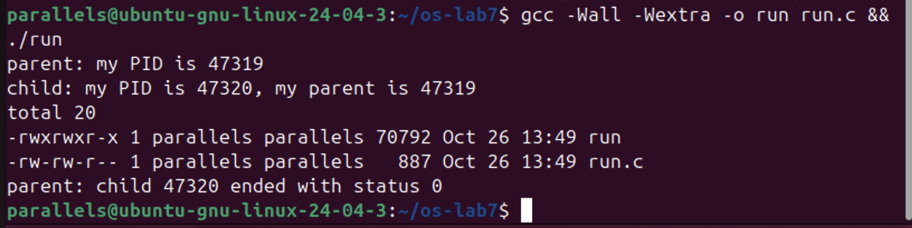</p>

<p align="center"><i>Figure 7.1.1 – run.c: the child becomes ls -l</i></p>

The parent (PID 47319) printed its line first, then the child (PID 47320) printed its PID and the PID of its parent, 47319. After that the child turned into ls and printed the listing of the directory, and only at the end did the parent print that child 47320 ended with status 0. The order of the lines is always the same because the parent is blocked in waitpid until ls finishes.

Next, the execlp line was changed with sed so that the child runs date instead of ls:

```bash
sed -i 's|execlp("ls", "ls", "-l", (char \*)NULL);|execlp("date", "date", (char *)NULL);|' run.c
grep -n execlp run.c
gcc -Wall -Wextra -o run run.c && ./run
```

<p align="center">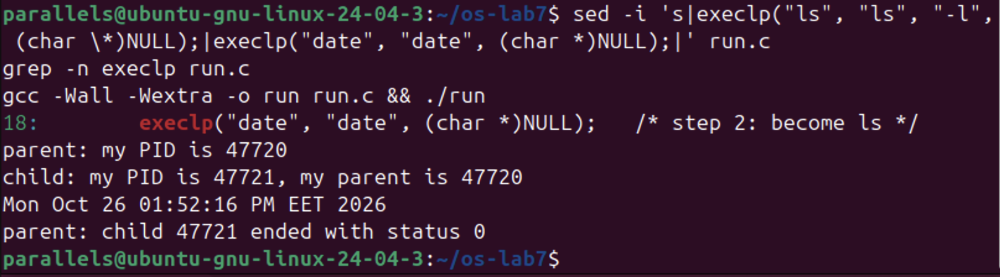</p>

<p align="center"><i>Figure 7.1.2 – The child runs date</i></p>

This time the child printed the current date and time (Mon Oct 26 01:52:16 PM EET 2026) and the parent again got status 0. Only the name of the program changed, the three steps stayed the same. Then the child was asked to run a program that does not exist:

```bash
sed -i 's|execlp("date", "date", (char \*)NULL);|execlp("nosuchprog", "nosuchprog", (char *)NULL);|' run.c
grep -n execlp run.c
gcc -Wall -Wextra -o run run.c && ./run
```

<p align="center">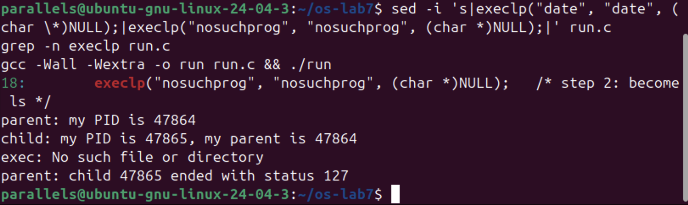</p>

<p align="center"><i>Figure 7.1.3 – exec of a program that does not exist</i></p>

execlp could not find nosuchprog in PATH, so it returned, perror printed "exec: No such file or directory" and the child ended with exit(127). The parent reported status 127. At the end run.c was changed back to the ls version, which is the submitted one.

**Answers to the questions:**

1. A successful exec replaces the whole program of the child with the new program (ls or date), so the code that comes after execlp, including perror("exec"), does not exist any more in that process and is never executed. exec returns only when it fails, and that happened only with nosuchprog, because there is no such file in PATH. That is why the error message appears only in that case.

2. The child prints "my parent is 47319" (and 47720, 47864 in the other runs), which is exactly the number that the parent printed in its first line "parent: my PID is 47319". So it is the PID of the original ./run process that called fork.

3. With ls (and with date) the parent sees status 0, because the program finished successfully. With nosuchprog it sees status 127, which is the value passed to exit(127) in our code after the failed exec. 127 is the same code that the shell uses for "command not found".

### 3.2 Part 2 — A Zombie, on Purpose

zombie.c is a copy of the original run.c (the version with ls) with one extra line, sleep(20), right before waitpid. The child (ls) finishes almost immediately, but the parent sleeps for 20 seconds before waiting for it, so for that time nobody collects the exit status of the child. The line was added with sed, and the program was started in the background with its output thrown away:

```bash
cp run.c zombie.c
sed -i '/waitpid(pid, &status, 0);/i\    sleep(20);    /* the new line */' zombie.c
grep -n -B1 -A1 sleep zombie.c
gcc -Wall -Wextra -o zombie zombie.c
./zombie > /dev/null &
sleep 2; ps -o pid,ppid,stat,cmd
```

<p align="center">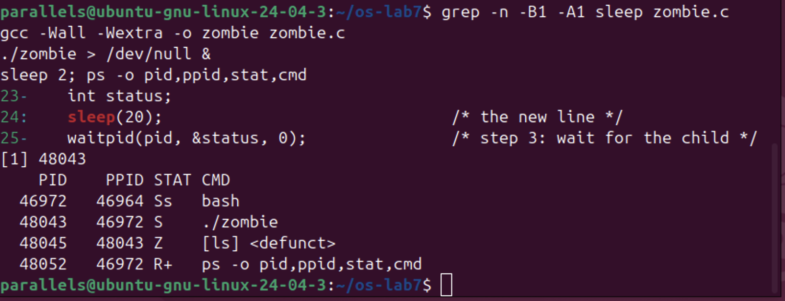</p>

<p align="center"><i>Figure 7.2.1 – The child ls is a zombie while the parent sleeps</i></p>

The process table shows ./zombie (PID 48043, state S – sleeping) and its child 48045, shown as [ls] <defunct> with state Z. The child has already ended, but its entry stays in the table because the parent has not called waitpid yet. After more than 20 seconds ps was run again:

```bash
ps -o pid,ppid,stat,cmd
```

<p align="center">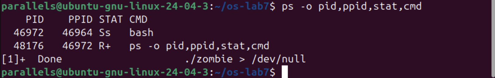</p>

<p align="center"><i>Figure 7.2.2 – The zombie is gone after the parent waited</i></p>

Both the zombie and ./zombie disappeared, and bash reported "[1]+ Done ./zombie > /dev/null".

**Answers to the questions:**

1. ls has the letter Z in the STAT column, which means zombie ("defunct"): the process has terminated, but its entry is still kept in the process table, holding its exit status, until the parent waits for it.

2. No, after 20 seconds the [ls] <defunct> line is not there any more. It was removed by the line waitpid(pid, &status, 0); in zombie.c: when the parent woke up from sleep(20) it called waitpid, which collected the exit status and let the kernel free the entry. After that the parent printed its last line and ended too, so bash showed "Done".

### 3.3 Part 3 — Redirection: ls -l > out.txt

redirect.c does by hand what the shell does for ls -l > out.txt. In the child it closes descriptor 1, then opens out.txt, which gets the smallest free number, and then executes ls. The message about the descriptor is printed to stderr (descriptor 2), so that it still reaches the screen. The code:

```c
#include <stdio.h>
#include <stdlib.h>
#include <fcntl.h>
#include <unistd.h>
#include <sys/wait.h>

/* does the same as the shell command: ls -l > out.txt */
int main(void)
{
    pid_t pid = fork();
    if (pid == 0) {
        close(1);                           /* descriptor 1 is now free */
        int fd = open("out.txt", O_WRONLY | O_CREAT | O_TRUNC, 0644);
        if (fd < 0) { perror("open"); exit(1); }
        fprintf(stderr, "open gave descriptor %d\n", fd);
        execlp("ls", "ls", "-l", (char *)NULL);   /* ls writes to 1, as always */
        perror("exec");
        exit(127);
    }
    waitpid(pid, NULL, 0);
    printf("done: the listing is in out.txt\n");
    return 0;
}
```

```bash
gcc -Wall -Wextra -o redirect redirect.c && ./redirect
head -3 out.txt
```

<p align="center">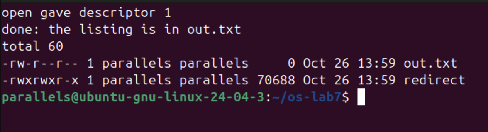</p>

<p align="center"><i>Figure 7.3.1 – open gave descriptor 1, and the listing is in out.txt</i></p>

The child printed "open gave descriptor 1", the parent printed "done: the listing is in out.txt", and the listing itself did not appear on the screen. head -3 out.txt shows that it was written into the file ("total 60", out.txt and redirect). out.txt appears with size 0 in its own listing because ls looked at it while the file was still empty.

**Answers to the questions:**

1. open gave descriptor 1. open always returns the lowest-numbered descriptor that is free in the process. 0 (stdin) and 2 (stderr) were still open, and 1 had just been closed with close(1), so 1 was the smallest free number.

2. ls always writes its output to descriptor 1 and does not care what is behind it. exec keeps the table of open descriptors, so in the new ls program descriptor 1 is still out.txt and not the terminal. That is why the listing went into the file and not to the screen, without changing ls at all.

3. To redirect the errors (like 2> err.txt) we would close descriptor 2 before open, so open would return 2 and everything written to standard error would go into the file.

### 3.4 Part 4 — A Pipe: ls /etc | wc -l

pipeline.c builds the pipeline by hand: one pipe and two children. In the first child, descriptor 1 is closed and dup(p[1]) puts the write end into number 1, then the child becomes ls /etc. In the second child, descriptor 0 is closed and dup(p[0]) puts the read end into number 0, then the child becomes wc -l. Every process closes the pipe ends it does not use, and the parent waits for both children. The code:

```c
#include <stdio.h>
#include <stdlib.h>
#include <unistd.h>
#include <sys/wait.h>

/* does the same as the shell command: ls /etc | wc -l */
int main(void)
{
    int p[2];
    if (pipe(p) < 0) { perror("pipe"); return 1; }

    if (fork() == 0) {          /* ls: its 1 becomes p[1] */
        close(1);
        dup(p[1]);              /* smallest free number: 1 */
        close(p[0]);
        close(p[1]);
        execlp("ls", "ls", "/etc", (char *)NULL);
        perror("exec ls");
        exit(127);
    }

    if (fork() == 0) {          /* wc: its 0 becomes p[0] */
        close(0);
        dup(p[0]);              /* smallest free number: 0 */
        close(p[0]);
        close(p[1]);
        execlp("wc", "wc", "-l", (char *)NULL);
        perror("exec wc");
        exit(127);
    }

    close(p[0]);                /* the parent uses neither end */
    close(p[1]);
    wait(NULL);
    wait(NULL);
    return 0;
}
```

```bash
gcc -Wall -Wextra -o pipeline pipeline.c && ./pipeline
ls /etc | wc -l
```

<p align="center">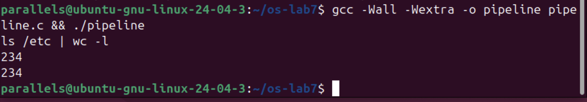</p>

<p align="center"><i>Figure 7.4.1 – pipeline.c compared with the real shell</i></p>

Both the program and the shell printed 234, so the hand-made pipe works exactly like the | of bash.

Then the program was broken on purpose: in the parent, the line close(p[1]); was turned into a comment. To keep pipeline.c correct for submission, the change was made in a copy, pipeline_bug.c. The program hangs, so it was started in the background, the process table was checked and then the job was killed:

```bash
sed '/the parent uses neither end/{n;s|close(p\[1\]);|/* close(p[1]); */|}' pipeline.c > pipeline_bug.c
grep -n -A1 "neither end" pipeline_bug.c
gcc -Wall -Wextra -o pipeline_bug pipeline_bug.c
./pipeline_bug &
sleep 2; ps -o pid,ppid,stat,cmd
kill %1
```

<p align="center">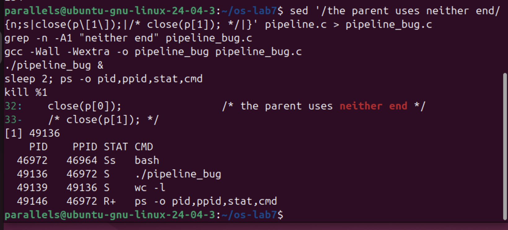</p>

<p align="center"><i>Figure 7.4.2 – With the parent's p[1] open, wc never ends</i></p>

grep confirms that line 33 is now /* close(p[1]); */. The program printed no number at all. ps shows ./pipeline_bug (49136) and its child wc -l (49139), both sleeping (S), while ls is not in the list any more: it has already finished and was collected by the first wait(NULL).

**Answers to the questions:**

1. Yes, ./pipeline and ls /etc | wc -l both printed 234.

2. wc never ends. ls writes the 234 names into the pipe and exits normally, but wc -l stays in state S, as the ps output shows.

3. wc is waiting for end of file on the pipe, and end of file comes only when every write end of the pipe is closed, but the parent still keeps p[1] open (and the parent itself is waiting for wc, so neither of them can ever finish).

### 3.5 Optional — Three Stages

pipeline3.c builds ls /usr/bin | grep x | wc -l with two pipes and three children: a connects ls to grep and b connects grep to wc. The grep child replaces both its 0 (with a[0]) and its 1 (with b[1]). Every child closes all four pipe ends after its dup, and so does the parent, otherwise grep or wc would never see end of file. The code:

```c
#include <stdio.h>
#include <stdlib.h>
#include <unistd.h>
#include <sys/wait.h>

/* does the same as the shell command: ls /usr/bin | grep x | wc -l */
int main(void)
{
    int a[2], b[2];                 /* a: ls -> grep, b: grep -> wc */
    if (pipe(a) < 0 || pipe(b) < 0) { perror("pipe"); return 1; }

    if (fork() == 0) {              /* ls: its 1 becomes a[1] */
        close(1); dup(a[1]);
        close(a[0]); close(a[1]); close(b[0]); close(b[1]);
        execlp("ls", "ls", "/usr/bin", (char *)NULL);
        perror("exec ls"); exit(127);
    }

    if (fork() == 0) {              /* grep: its 0 becomes a[0], its 1 becomes b[1] */
        close(0); dup(a[0]);
        close(1); dup(b[1]);
        close(a[0]); close(a[1]); close(b[0]); close(b[1]);
        execlp("grep", "grep", "x", (char *)NULL);
        perror("exec grep"); exit(127);
    }

    if (fork() == 0) {              /* wc: its 0 becomes b[0] */
        close(0); dup(b[0]);
        close(a[0]); close(a[1]); close(b[0]); close(b[1]);
        execlp("wc", "wc", "-l", (char *)NULL);
        perror("exec wc"); exit(127);
    }

    close(a[0]); close(a[1]); close(b[0]); close(b[1]);  /* the parent uses no end */
    wait(NULL); wait(NULL); wait(NULL);
    return 0;
}
```

```bash
gcc -Wall -Wextra -o pipeline3 pipeline3.c && ./pipeline3
ls /usr/bin | grep x | wc -l
```

<p align="center">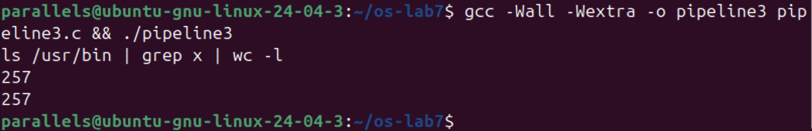</p>

<p align="center"><i>Figure 7.5.1 – The three-stage pipeline compared with the shell</i></p>

Both printed 257, so the three-stage pipeline gives the same result as the shell.


## 4 LABORATORY WORK 8 — THE SAME CALLS, INSIDE YOUR OWN OS (xv6)


Lab 8 uses the ~/xv6-riscv tree from the previous labs on the same Ubuntu machine. The RISC-V cross-compiler (riscv64-linux-gnu-gcc) and the emulator qemu-system-riscv64 were already installed. xv6 is started with make qemu and left with Ctrl-A X.

### 4.1 Part 1 — run, Inside xv6

user/run.c is the same three-step program as run.c from Lab 7, written for xv6: there is no glibc, only the system calls of the kernel. The child becomes echo with the arguments "hello from the child". The code:

```c
#include "kernel/types.h"
#include "user/user.h"

// the three steps of the shell, inside xv6: echo hello from the child
int
main(int argc, char *argv[])
{
  printf("parent: my pid is %d\n", getpid());

  int pid = fork();                 // step 1: copy myself
  if(pid < 0){
    printf("fork failed\n");
    exit(1);
  }

  if(pid == 0){                     // only the child runs this
    printf("child: my pid is %d\n", getpid());
    char *args[] = { "echo", "hello", "from", "the", "child", 0 };
    exec("echo", args);             // step 2: become echo
    printf("exec failed\n");        // runs only if exec failed
    exit(1);
  }

  int status;
  wait(&status);                    // step 3: wait for the child
  printf("parent: child %d ended with status %d\n", pid, status);
  exit(0);
}
```

Then the line $U/_run\ was added to the UPROGS list of the Makefile, right after $U/_zombie\ (with a sed command, so the file did not have to be opened in an editor), and the list was checked with grep -n 'U/_' Makefile:

```makefile
UPROGS=\
	...
	$U/_zombie\
	$U/_run\
	...
```

<p align="center">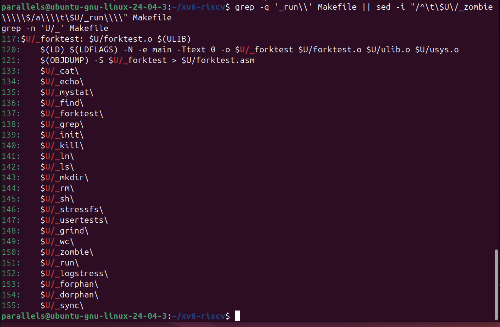</p>

<p align="center"><i>Figure 8.1.1 – $U/_run\ added to UPROGS (line 151)</i></p>

The list also contains mystat and find from Labs 5–6. After make qemu the program was run in the xv6 shell:

```bash
make qemu
$ run
```

<p align="center">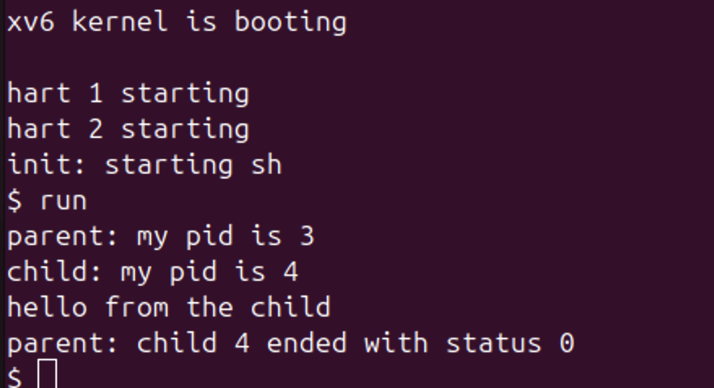</p>

<p align="center"><i>Figure 8.1.2 – run inside xv6: the child becomes echo</i></p>

The output is the same as in the lab statement: the parent has pid 3 (pid 1 is init and pid 2 is the shell sh), the child has pid 4, then "hello from the child" is printed and the parent reports status 0. Next, the child was changed to run ls:

```bash
sed -i -e 's|{ "echo", "hello", "from", "the", "child", 0 }|{ "ls", 0 }|' \
       -e 's|exec("echo", args);|exec("ls", args);  |' \
       -e 's|become echo|become ls|' user/run.c
grep -n 'args' user/run.c
make qemu
$ run
```

<p align="center">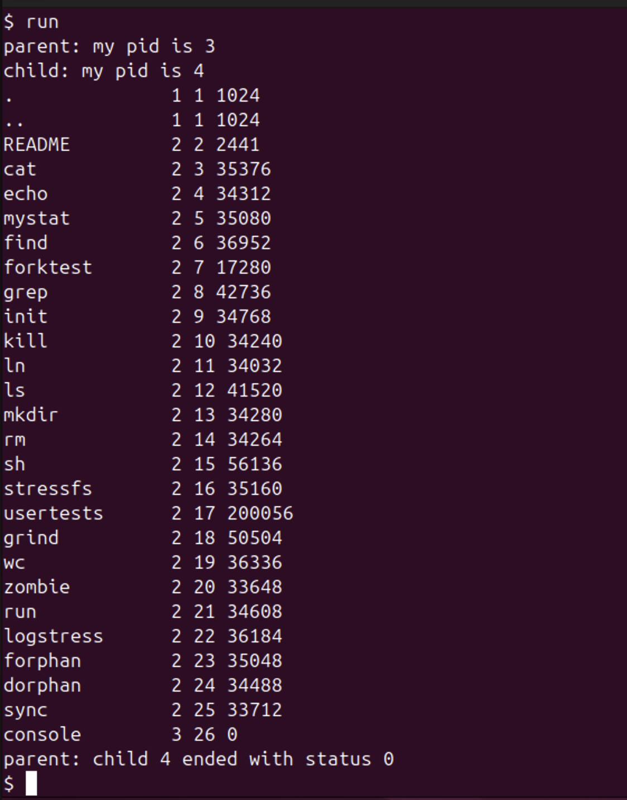</p>

<p align="center"><i>Figure 8.1.3 – The child runs the xv6 ls</i></p>

This time the child turned into the xv6 ls, which listed the root directory of the xv6 file system (including run itself, inode 21), and the parent again got status 0. Finally, the child was asked to exec a program that does not exist:

```bash
sed -i 's|exec("ls", args);|exec("nosuchprog", args);|' user/run.c
make qemu
$ run
```

<p align="center">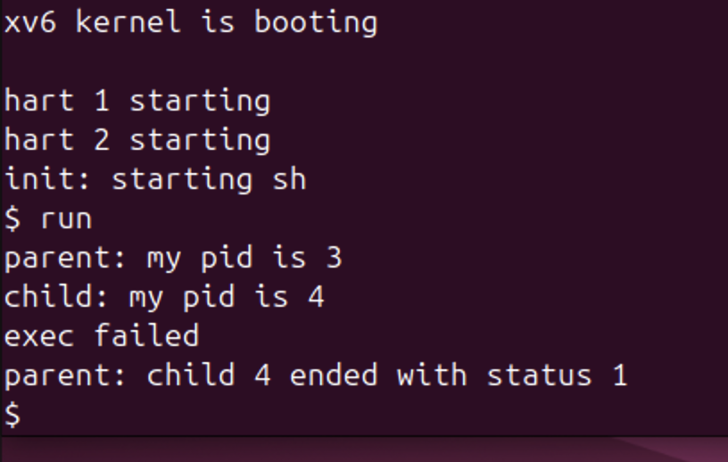</p>

<p align="center"><i>Figure 8.1.4 – exec of a program that does not exist in xv6</i></p>

exec failed, so the child printed "exec failed" and ended with exit(1), and the parent reported status 1. After this, user/run.c was changed back to the echo version.

**Answers to the questions:**

1. In xv6 run.c uses fork(), exec("echo", args) and wait(&status). On Linux in Lab 7 run.c used fork(), execlp("ls", "ls", "-l", NULL) and waitpid(pid, &status, 0). What is the same is the whole idea and the order of the three steps: fork makes a copy of the process, exec replaces the program in the child and does not return if it succeeds, and wait makes the parent sleep until the child ends and gives its exit status. Only the details differ: exec in xv6 takes an array of arguments (like execv) and no PATH search is done, while execlp takes a list and searches PATH; and on Linux the status has to be decoded with WEXITSTATUS.

2. "hello from the child" is printed by echo, not by the code of run. The child of run only builds the argument array and calls exec; after a successful exec the process is running the echo program, which prints its arguments. run itself prints only the lines that start with "parent:" and "child:".

3. The status is simply the number that the child passes to exit. In the xv6 run.c the line after exec is exit(1), so the parent sees 1, while in the Linux run.c it is exit(127), so the parent sees 127. 127 is only a convention (the one bash uses for "command not found"); the kernel just passes on whatever value the child gives.

### 4.2 Part 2 — pingpong

In user/pingpong.c the parent and the child talk through two pipes: p2c (parent to child) and c2p (child to parent). Each of them first closes the ends it does not use. The parent writes one byte into p2c[1]; the child reads it from p2c[0], prints "<pid>: received ping", writes the byte back into c2p[1] and exits; the parent reads it from c2p[0], prints "<pid>: received pong" and waits for the child. The completed TODO lines use read(fd, &b, 1) and write(fd, &b, 1):

```c
#include "kernel/types.h"
#include "user/user.h"

int
main(int argc, char *argv[])
{
  int p2c[2], c2p[2];   // parent-to-child, child-to-parent
  char b;

  pipe(p2c);
  pipe(c2p);
  if(fork() == 0){
    close(p2c[1]); close(c2p[0]);   // the ends the child does not use
    read(p2c[0], &b, 1);            // read 1 byte from p2c[0] into b
    printf("%d: received ping\n", getpid());
    write(c2p[1], &b, 1);           // write the byte b into c2p[1]
    exit(0);
  }
  close(p2c[0]); close(c2p[1]);     // the ends the parent does not use
  b = 'x';
  write(p2c[1], &b, 1);             // write 1 byte into p2c[1]
  read(c2p[0], &b, 1);              // read 1 byte from c2p[0] into b
  printf("%d: received pong\n", getpid());
  wait(0);
  exit(0);
}
```

For the optional part, user/primes.c prints the primes from 2 to 35 with a chain of processes. The first process writes the numbers 2..35 into a pipe. Each stage reads its first number p, which is always a prime, prints "prime p", creates a new pipe and a child (the next stage), and forwards only the numbers that are not divisible by p. When its input pipe is closed, a stage closes its output, so the next stage also sees end of file, and every stage waits for its child. The code:

```c
#include "kernel/types.h"
#include "user/user.h"

// one stage of the sieve: reads numbers from 'left', prints the first one
// (a prime p) and forwards to the next stage only the numbers not divisible by p
void sieve(int left) __attribute__((noreturn));

void
sieve(int left)
{
  int p, n;
  if(read(left, &p, sizeof(p)) != sizeof(p)){   // nothing left: last stage
    close(left);
    exit(0);
  }
  printf("prime %d\n", p);

  int right[2];
  pipe(right);
  if(fork() == 0){          // the next stage
    close(right[1]);
    close(left);
    sieve(right[0]);
  }
  close(right[0]);
  while(read(left, &n, sizeof(n)) == sizeof(n)){
    if(n % p != 0)
      write(right[1], &n, sizeof(n));
  }
  close(left);
  close(right[1]);          // the next stage sees end of file
  wait(0);
  exit(0);
}

int
main(int argc, char *argv[])
{
  int p[2];
  pipe(p);
  if(fork() == 0){
    close(p[1]);
    sieve(p[0]);
  }
  close(p[0]);
  for(int i = 2; i <= 35; i++)
    write(p[1], &i, sizeof(i));
  close(p[1]);
  wait(0);
  exit(0);
}
```

Both programs were added to UPROGS after $U/_run\ in the same way, and xv6 was started with make qemu:

```makefile
	$U/_zombie\
	$U/_run\
	$U/_primes\
	$U/_pingpong\
```

At the first try, primes worked but pingpong answered "exec pingpong failed", which means _pingpong was not in the file system image. The file and the UPROGS line were correct, so the image was simply built before user/pingpong.c was ready. A clean build fixed it:

```bash
make clean
make qemu
$ pingpong
$ primes
```

<p align="center">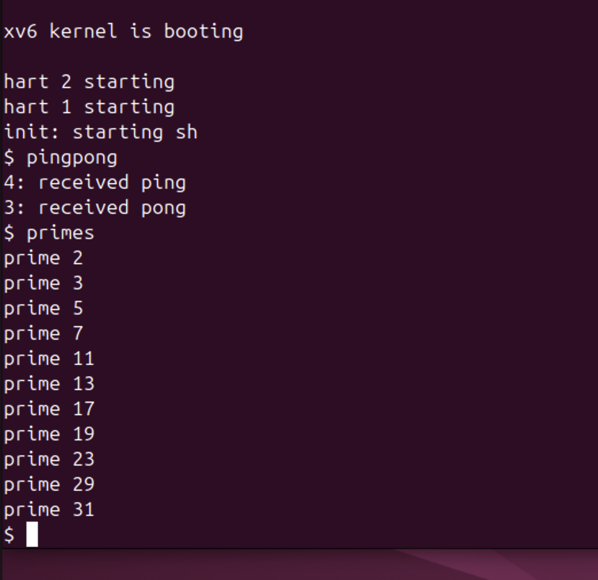</p>

<p align="center"><i>Figure 8.2.1 – pingpong and primes in xv6</i></p>

The child (pid 4) printed "4: received ping" first, and then the parent (pid 3) printed "3: received pong". primes printed all the primes up to 35: 2, 3, 5, 7, 11, 13, 17, 19, 23, 29 and 31.

**Answers to the questions:**

1. A pipe works only in one direction and does not know who is reading. With a single pipe, after the parent writes the ping byte it would immediately call read on the same pipe and could read back its own byte before the child does, so the child would wait forever. Also, neither side could tell whether a byte is a ping or a pong. With two pipes there is one channel for each direction: the parent only writes into p2c and only reads from c2p, and the child does the opposite.

2. The call read(c2p[0], &b, 1) in the parent. read on an empty pipe blocks, so the parent sleeps there until the child writes the byte back. In the same way, the read(p2c[0], &b, 1) in the child makes the child wait for the ping. This is also why "received ping" is always printed before "received pong".


## CONCLUSION


Lab 7 showed in practice what the shell does every time a command is typed. A process is born only through fork, which makes a copy, and becomes another program through exec, which replaces the code but keeps the PID and the open files. Because a successful exec never returns, the error line after it ran only for nosuchprog, and the exit status (0 or 127) went back to the parent through waitpid. With sleep(20) before waitpid the finished ls stayed in the process table as a zombie with state Z, and it disappeared exactly when the parent called waitpid.

Redirection and pipes turned out to be just games with file descriptor numbers. Since open and dup always return the smallest free number, closing 1 and then opening a file makes ls write into out.txt without changing ls at all, and replacing 1 and 0 with the two ends of a pipe gives ls /etc | wc -l, which printed the same 234 as bash (and 257 for the three-stage version). Leaving one write end open in the parent showed the most important rule of pipes: the reader gets end of file only when every write end is closed, otherwise wc waits forever.

Lab 8 confirmed that the same calls exist inside xv6. run worked with echo, ls and a missing program just like on Linux, the only difference being the status 1 instead of 127, which comes from our own exit(1). pingpong showed that two pipes are needed for a conversation in two directions and that a blocking read is enough to synchronise two processes, and primes built a whole chain of processes connected with pipes. A small practical lesson was that a new program in UPROGS appears in xv6 only after fs.img is rebuilt, which make clean guaranteed.

## REFERENCES


1. Silberschatz, A., Galvin, P. B., Gagne, G. Operating System Concepts. 10th ed. Wiley, 2018. Chapter 3 (processes) and Chapter 3.7 (pipes).

2. Kerrisk, M. The Linux Programming Interface. No Starch Press, 2010. Chapters 24–27 (fork, exit, wait, exec) and 44 (pipes).

3. Cox, R., Kaashoek, F., Morris, R. xv6: a simple, Unix-like teaching operating system (RISC-V version), chapter 1 "Operating system interfaces". MIT. Available at: https://pdos.csail.mit.edu/6.1810/

4. MIT 6.1810 Operating System Engineering, Lab "Xv6 and Unix utilities" (pingpong, primes). Available at: https://pdos.csail.mit.edu/6.1810/

5. The Linux man-pages project: fork(2), execve(2), exec(3), wait(2), open(2), dup(2), pipe(2), ps(1). Available at: https://man7.org/linux/man-pages/
