# Report on laboratory works no. 9–10

**Course:** Operating Systems  
**Topic:** System Calls: Linux and xv6  
**Done by:** st. gr. FAF-243, Buliga Vladislav  
**Checked by:** Reițman Patricia, asist. univ.  
Chișinău, 2026

---

## 1 AIM OF THE WORK


### 1.1 Purpose of the laboratory works

Laboratory works 9 and 10 study the system call, the door between a user program and the kernel, from both sides. In Lab 9 the door is watched from the outside on a real Linux system: strace prints every system call that a program makes, first for the real command ls, then for a small program that calls open, write, read and close directly. In Lab 10 the door is built from the inside: a new system call, trace, is added to the xv6 kernel, so that a process can ask the kernel to print every system call it makes. On the way, one number, 23, is followed from a user program down to a function in the kernel.

### 1.2 Problem statement

**Lab 9 – Watching System Calls with strace (Linux):**

- run strace on ls -l and find the call that prints to the screen and the descriptor it uses;
- write syscalls.c, which opens a file, writes a line and reads it back using only system calls, and watch it with strace;
- count the system calls of a program with strace -c and look at one kind of call (write) separately.

**Lab 10 – Add Your Own System Call: trace (xv6):**

- give the new call the number 23 and add the user side: the declaration, the usys.pl stub and the program user/trace.c;
- add the kernel side: a mask in struct proc, the handler sys_trace, the entry in the system call table, a table of names and the print after each call, and inheritance of the mask in fork;
- play with the mask: trace all calls, only fork, only write, and only open and close.

## 2 THEORETICAL BACKGROUND


### 2.1 System Calls

A user program cannot touch the hardware, other processes or the disk directly: it runs in user mode, and only the kernel runs in supervisor mode. When a program needs something from the operating system (open a file, write bytes, create a process), it makes a system call: it puts the number of the call and its arguments in registers and executes a special instruction (syscall on x86-64, svc on ARM64, ecall on RISC-V). The processor switches to the kernel, which looks at the number, runs the matching function and puts the return value back into a register. Library functions such as printf or fopen are not system calls; they run in user space and, when needed, call write or openat underneath.

### 2.2 strace

strace is a Linux tool that runs a program and uses the ptrace mechanism of the kernel to stop it at every system call. For each call it prints the name, the arguments and the return value, for example write(1, "total 0\n", 8) = 8. The output goes to standard error, so it does not mix with the program's own standard output when that is redirected. Useful options are -e trace=NAMES (show only some calls), -f (follow child processes) and -c (do not print the calls, only a table with the number of calls of each kind and the errors).

### 2.3 File Descriptors and Buffering

Every process starts with three open descriptors inherited from its parent (the shell): 0 – standard input, 1 – standard output and 2 – standard error. open (on Linux the system call openat) always returns the smallest free number, so the first file a program opens gets 3. printf does not call write every time: the C library keeps the text in a buffer. When standard output is a terminal the buffer is flushed at every newline (line buffering); when it is a file or a pipe it is flushed only when it is full or when the program ends (full buffering), so several printfs can become a single write.

### 2.4 System Calls in xv6

In xv6 on RISC-V, each system call has a number defined in kernel/syscall.h. The user side is generated by the script user/usys.pl: for every entry it writes a stub of three instructions, li a7, NUMBER; ecall; ret. The ecall instruction traps into the kernel, which saves the user registers in the trapframe of the process and calls syscall() in kernel/syscall.c. syscall() reads the number from a7, uses it as an index in the table syscalls[] of handler functions, runs the handler and stores its return value in a0, which becomes the return value seen by the user program. Handlers read their arguments from the saved registers with helpers such as argint(n, &x).

### 2.5 A Bit Mask

A bit mask stores a set of small numbers in one integer: bit N set to 1 means "N is in the set". For trace, bit N on means "print system call number N". The mask for one call is 2 to the power of its number (read is 5, so 32), several calls are added together, and the test (mask >> num) & 1 checks whether bit num is set. The value 2147483647 (2^31 − 1) has all 31 low bits on, so every call is traced.


## 3 LABORATORY WORK 9 — WATCHING SYSTEM CALLS WITH strace (LINUX)


The work was done on the same Ubuntu 24.04 virtual machine as the previous labs. It runs on an ARM64 processor (aarch64), which can be seen in the paths of the libraries. strace was already installed, version 6.8:

```bash
mkdir -p ~/os-lab9 && cd ~/os-lab9
sudo apt install -y strace
strace -V | head -1
```

<p align="center">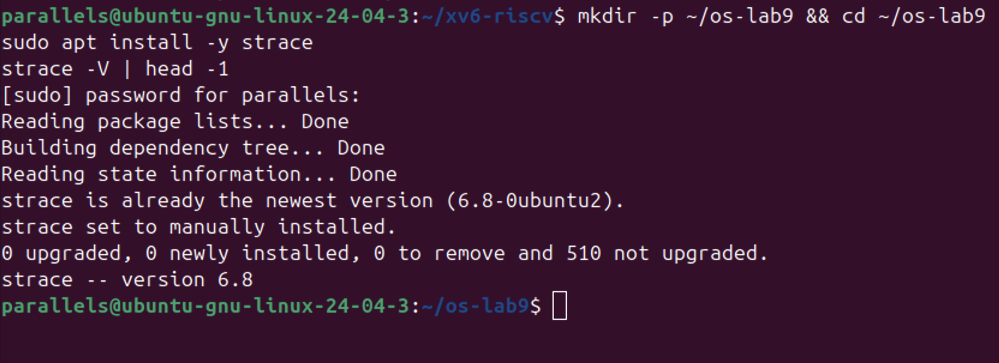</p>

<p align="center"><i>Figure 9.0.1 – strace is installed (version 6.8)</i></p>

### 3.1 Part 1 — See the Calls of a Real Command

strace was run on ls -l, showing only the calls openat, read, write and close, in the empty directory ~/os-lab9:

```bash
strace -f -e trace=openat,read,write,close ls -l
```

<p align="center">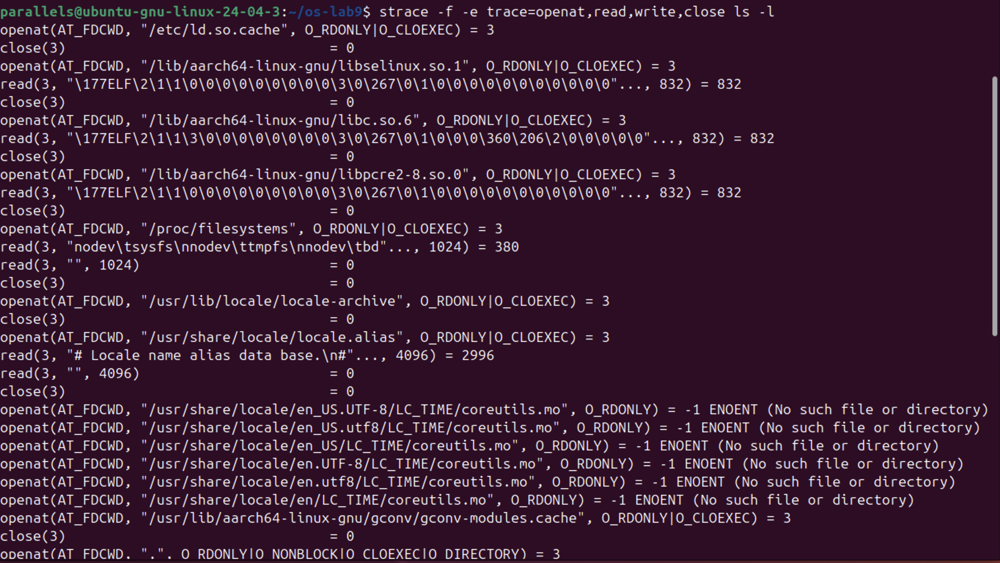</p>

<p align="center"><i>Figure 9.1.1 – The system calls of ls -l (beginning)</i></p>

<p align="center">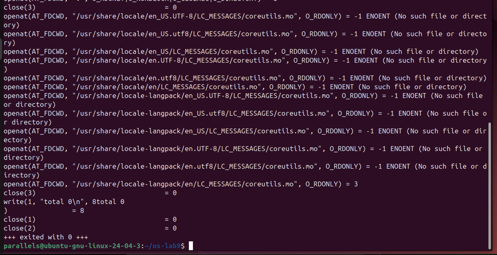</p>

<p align="center"><i>Figure 9.1.2 – The system calls of ls -l (end)</i></p>

The output shows what ls does before it prints anything. First the dynamic loader opens /etc/ld.so.cache and the shared libraries libselinux, libc.so.6 and libpcre2, and reads the first 832 bytes of each; they start with \177ELF, the magic number of executable files. Then ls reads /proc/filesystems and the locale files. Many openat calls on coreutils.mo files return -1 ENOENT: ls looks for a translation of its messages in several places, and most of them do not exist. Then it opens the current directory with O_DIRECTORY. Only at the very end it prints with write(1, "total 0\n", 8) = 8, which is mixed with the printed text total 0 itself, because both go to the terminal. The number of calls was counted by sending the strace lines into wc -l and throwing away the output of ls:

```bash
strace -f -e trace=openat,read,write,close ls -l 2>&1 >/dev/null | wc -l
```

<p align="center">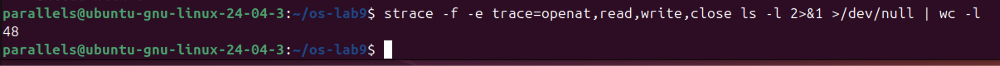</p>

<p align="center"><i>Figure 9.1.3 – Number of lines printed by strace</i></p>

wc printed 48. One line is "+++ exited with 0 +++", so a simple ls -l in an empty directory made 47 calls of only these four kinds, and just one of them printed something.

**Answers to the questions:**

1. ls prints to the screen with the system call write, and it writes to descriptor 1, the standard output: write(1, "total 0\n", 8) = 8.

### 3.2 Part 2 — A Program That Calls the Kernel Directly

syscalls.c opens note.txt for writing, writes the line "hello, kernel\n" with write, closes it, opens it again for reading and reads the line back with read. printf is used only to show the results on the screen. The code:

```bash
/* syscalls.c - open, write, read and close, using only system calls.
 * Build: gcc -Wall -Wextra -o syscalls syscalls.c
 * Run:   ./syscalls
 * See the calls: strace ./syscalls
 */
#include <fcntl.h>      /* open */
#include <unistd.h>     /* write, read, close */
#include <string.h>     /* strlen */
#include <stdio.h>      /* printf */

int main(void) {
    const char *msg = "hello, kernel\n";

    /* open() is a system call: ask the kernel for a file, get back a descriptor */
    int fd = open("note.txt", O_CREAT | O_WRONLY | O_TRUNC, 0644);
    if (fd < 0) { perror("open"); return 1; }
    printf("open returned descriptor %d\n", fd);

    /* write() is a system call: hand the bytes to the kernel */
    ssize_t n = write(fd, msg, strlen(msg));
    printf("write sent %zd bytes\n", n);
    close(fd);

    /* read it back, through the kernel again */
    fd = open("note.txt", O_RDONLY);
    char buf[64];
    n = read(fd, buf, sizeof(buf) - 1);
    buf[n] = '\0';
    printf("read got %zd bytes: %s", n, buf);
    close(fd);
    return 0;
}
```

```bash
gcc -Wall -Wextra -o syscalls syscalls.c && ./syscalls
cat note.txt
```

<p align="center">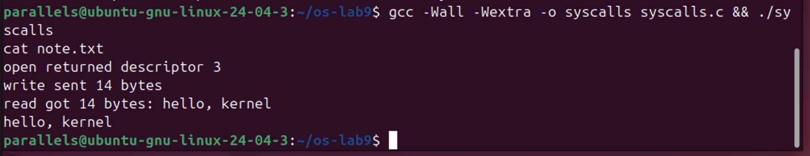</p>

<p align="center"><i>Figure 9.2.1 – Output of syscalls</i></p>

The output is exactly the expected one: open returned descriptor 3, write sent 14 bytes and read got the same 14 bytes back; cat confirms that note.txt really contains "hello, kernel". Then the same program was watched with strace:

```bash
strace -e trace=openat,write,read,close ./syscalls
```

<p align="center">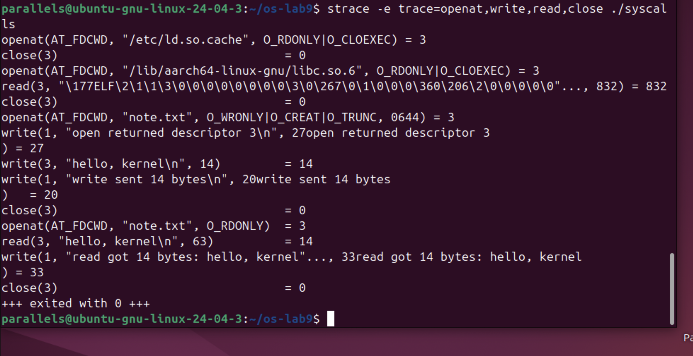</p>

<p align="center"><i>Figure 9.2.2 – The system calls of syscalls</i></p>

After the setup lines (ld.so.cache and libc.so.6) come the six calls of our code, one to one: openat(AT_FDCWD, "note.txt", O_WRONLY|O_CREAT|O_TRUNC, 0644) = 3, write(3, "hello, kernel\n", 14) = 14, close(3) = 0, openat(AT_FDCWD, "note.txt", O_RDONLY) = 3, read(3, "hello, kernel\n", 63) = 14 and close(3) = 0. Two details are visible. First, the C function open() is implemented by glibc with the newer system call openat, where AT_FDCWD means "relative to the current directory". Second, each printf became its own write(1, ...) right when it was called (27, 20 and 33 bytes), because standard output was the terminal, which is line buffered.

**Answers to the questions:**

1. Descriptors 0, 1 and 2 are already taken because every process starts with standard input (0), standard output (1) and standard error (2) open, inherited from the shell that started it. open always returns the smallest free number, so the first file opened by the program gets 3.

### 3.3 Part 3 — Count One Kind of Call

The page of the lab sheet with the instructions for Part 3 was missing, so this part was done with the counting mode of strace. strace -c prints a table with the number of calls of each kind instead of the calls themselves; the normal output of the program was thrown away. Then only the calls of one kind, write, were traced while the output of the program went into a file instead of the terminal:

```bash
strace -c ./syscalls > /dev/null
strace -e trace=write ./syscalls > out.txt
```

<p align="center">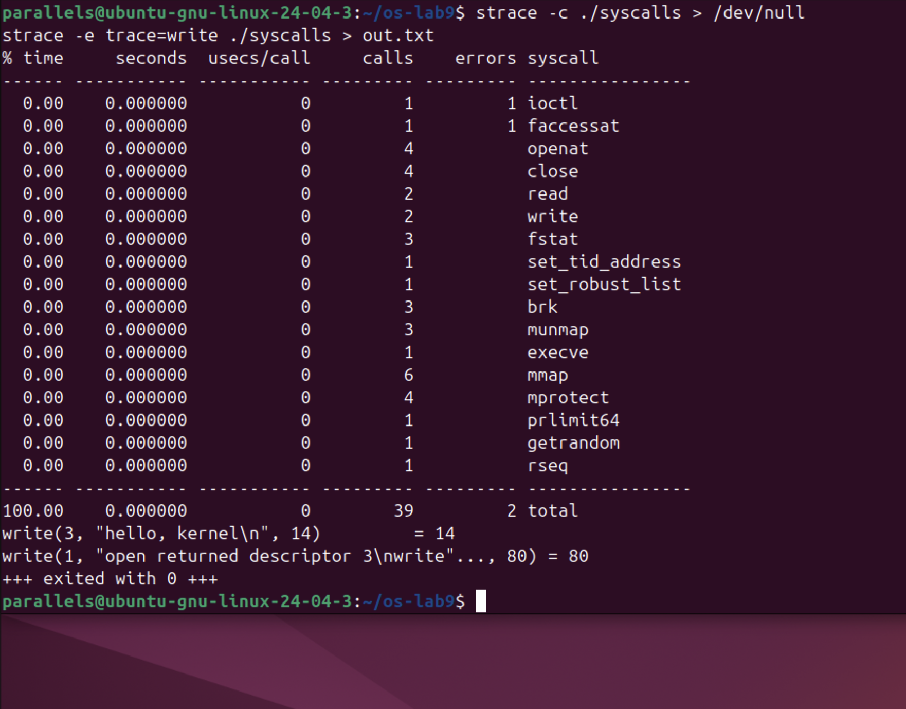</p>

<p align="center"><i>Figure 9.3.1 – strace -c, and the write calls when the output is a file</i></p>

The whole program made 39 system calls. Only 12 of them come from our code and printf: 4 openat, 4 close, 2 read and 2 write (4 openat and 4 close because the loader also opens ld.so.cache and libc). The rest is work done before main starts: execve loads the program, mmap, mprotect and munmap map the library into memory, brk prepares the heap, and calls like set_tid_address, set_robust_list, rseq and getrandom set up the thread and the C library. The 2 errors are normal: faccessat finds no /etc/ld.so.preload, and ioctl fails because /dev/null is not a terminal (this is how the C library checks which buffering to use).

The second command shows that buffering changes the system calls. With the output going into out.txt, the three printfs did not make three writes as on the terminal in Figure 9.2.2: the C library collected them and wrote everything at the end with a single write(1, "open returned descriptor 3\nwrite"..., 80) = 80. The write to note.txt (descriptor 3) stays the same, because it is a direct system call with no buffer.


## 4 LABORATORY WORK 10 — ADD YOUR OWN SYSTEM CALL: trace (xv6)


Lab 10 uses the ~/xv6-riscv tree from the previous labs. As the lab sheet warns, this xv6 is newer than the MIT 6.1810 version: number 22 is already taken by sync and the kernel prints with printk, so trace gets number 23. The edits were made with short sed commands, so that the files did not have to be opened in an editor; each command first checks with grep that the line is not already there.

### 4.1 Part 1 — The Number and the User Side

Five small edits give the call a number and teach the user side to ask for it:

- 1.1 kernel/syscall.h: #define SYS_trace 23 at the end of the file;
- 1.2 user/user.h: the declaration int trace(int); after int sync(void);
- 1.3 user/usys.pl: entry("trace"); at the end. At build time this script writes user/usys.S, where trace becomes three instructions: li a7, SYS_trace; ecall; ret;
- 1.4 the new program user/trace.c (below);
- 1.5 Makefile: the line $U/_trace\ in UPROGS, after $U/_zombie\.

```bash
grep -q SYS_trace kernel/syscall.h || echo '#define SYS_trace  23' >> kernel/syscall.h
grep -q 'int trace(int);' user/user.h || sed -i 's|^int sync(void);|int sync(void);\nint trace(int);|' user/user.h
grep -q 'entry("trace")' user/usys.pl || echo 'entry("trace");' >> user/usys.pl
```

user/trace.c sets the mask on itself with the new call, then becomes the command with exec. The mask stays, because exec keeps the same process (and the same struct proc):

```c
#include "kernel/types.h"
#include "kernel/stat.h"
#include "user/user.h"

int
main(int argc, char *argv[])
{
  if (argc < 3) {
    fprintf(2, "usage: trace mask command [args...]\n");
    exit(1);
  }
  if (trace(atoi(argv[1])) < 0) {
    fprintf(2, "trace: failed\n");
    exit(1);
  }
  exec(argv[2], argv + 2);
  fprintf(2, "trace: exec %s failed\n", argv[2]);
  exit(1);
}
```

<p align="center">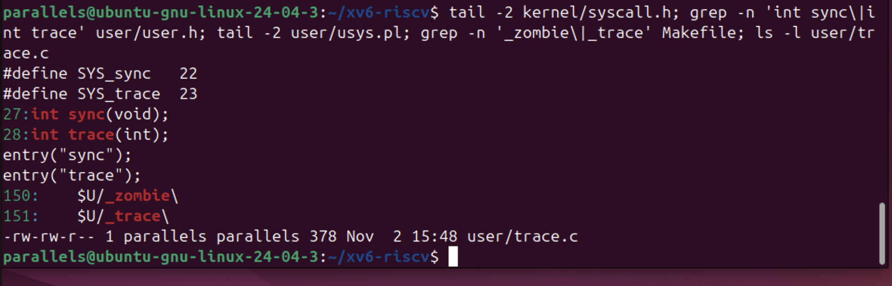</p>

<p align="center"><i>Figure 10.1.1 – The four edits of Part 1 and user/trace.c</i></p>

Check 1: the kernel does not have a function for 23 yet, so it must complain:

```bash
make qemu
$ trace 32 grep hello README
```

<p align="center">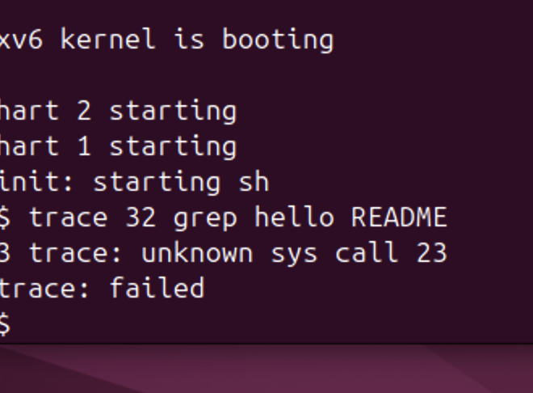</p>

<p align="center"><i>Figure 10.1.2 – Check 1: the kernel receives call number 23</i></p>

The message "3 trace: unknown sys call 23" comes from the else branch of syscall() in the kernel, so it proves that the program executed ecall with a7 = 23 and the kernel received the number. trace then printed "trace: failed", because the call returned -1.

### 4.2 Part 2 — The Kernel Side

2.1 kernel/proc.h: every process remembers its own mask, in a new field of struct proc after name:

```bash
  char name[16];               // Process name (debugging)
  int trace_mask;              // new: which calls to print
```

2.2 kernel/sysproc.c: the handler reads argument 0 (register a0) with argint and stores it in the current process:

```bash
uint64
sys_trace(void)
{
  int mask;
  argint(0, &mask);
  myproc()->trace_mask = mask;
  return 0;
}
```

2.3 kernel/syscall.c: the declaration extern uint64 sys_trace(void); and the entry [SYS_trace] = sys_trace, at place 23 of the table syscalls[]. 2.4: a table of names, syscallnames[], placed above syscall(), because the kernel only knows numbers, and two lines right after the call, so that the return value is already in a0:

```bash
    p->trapframe->a0 = syscalls[num]();
    if ((p->trace_mask >> num) & 1)                   // new
      printk("%d: syscall %s -> %ld\n",               // new
             p->pid, syscallnames[num], p->trapframe->a0);
```

2.5 kernel/proc.c: in fork (called kfork in this tree), right after the name is copied, the child gets the mask of its parent:

```bash
  safestrcpy(np->name, p->name, sizeof(p->name));
  np->trace_mask = p->trace_mask;      // new
```

The changes were checked with git diff. In total 8 files changed with 36 new lines (the Makefile shows 6 because it also counts mystat, find, run, primes and pingpong from the earlier labs), plus the new file user/trace.c:

```bash
git --no-pager diff --stat
git --no-pager diff kernel/syscall.c
```

<p align="center">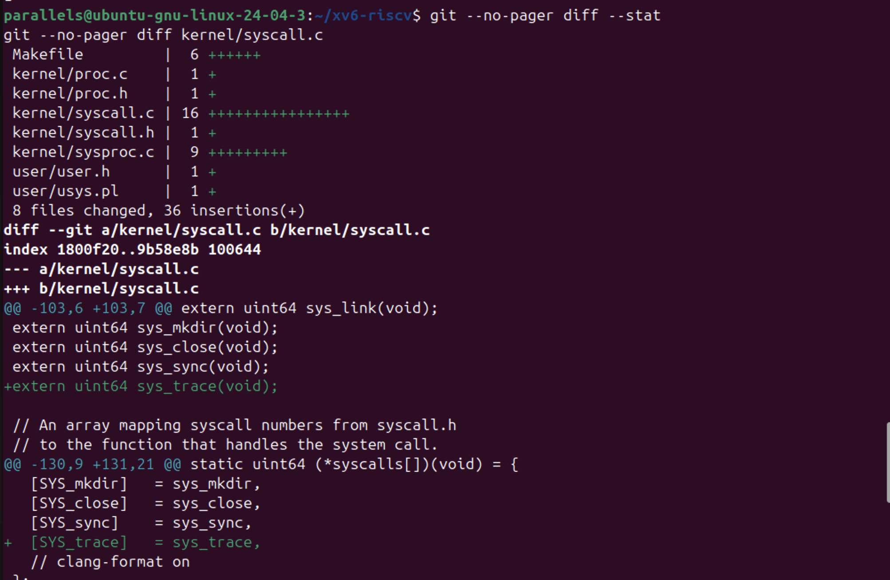</p>

<p align="center"><i>Figure 10.2.1 – Changed files, and the extern line and table entry in syscall.c</i></p>

<p align="center">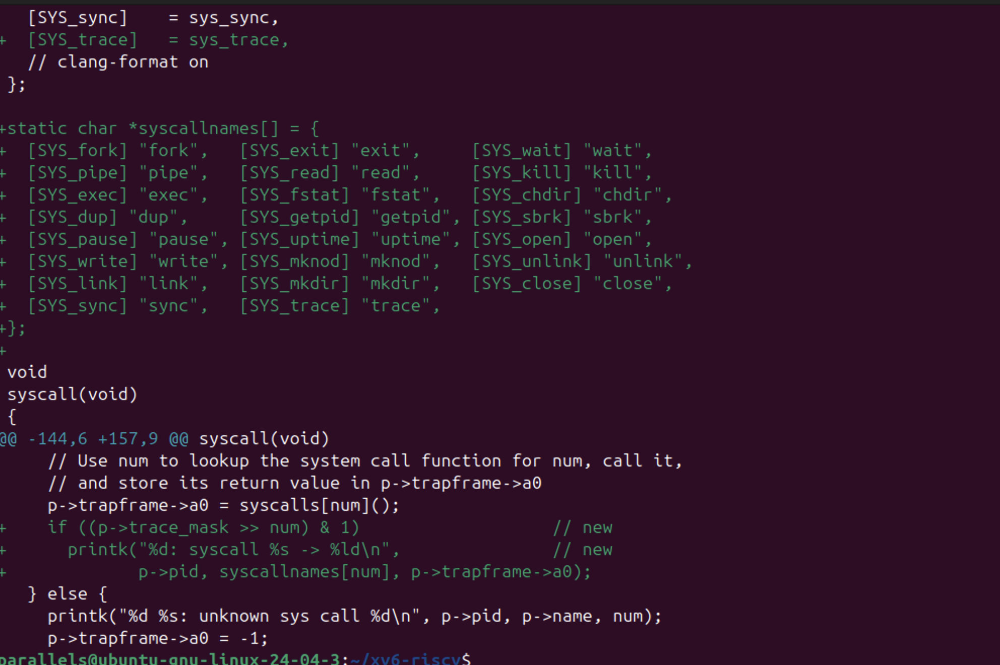</p>

<p align="center"><i>Figure 10.2.2 – The table of names and the print after the call in syscall()</i></p>

One problem appeared here. When the block for sysproc.c was pasted into the terminal, its last line EOF did not arrive cleanly, so the here-document did not end and the following commands were also appended into kernel/sysproc.c. The build stopped with C errors about lines like grep -q ... inside sysproc.c. The file was repaired with a short python3 command that keeps everything up to the first sys_trace, removes the rest and writes the function again:

<p align="center">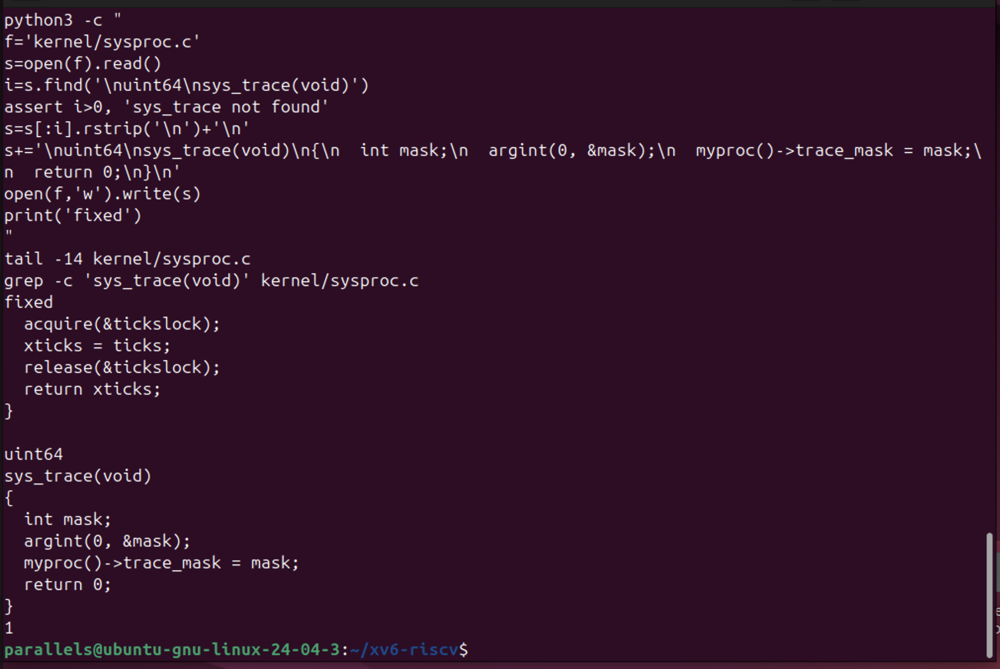</p>

<p align="center"><i>Figure 10.2.3 – kernel/sysproc.c after the repair: one clean sys_trace</i></p>

Check 2:

```bash
make qemu
$ trace 32 grep hello README
```

<p align="center">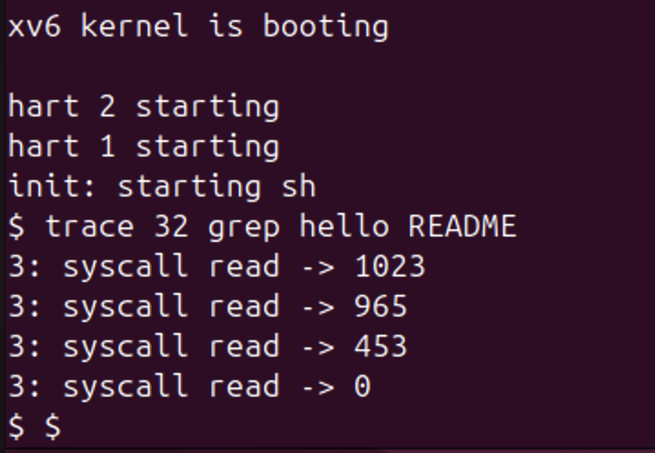</p>

<p align="center"><i>Figure 10.2.4 – Check 2: trace 32 prints the read calls of grep</i></p>

The numbers are exactly the expected ones: 1023 + 965 + 453 = 2441, the size of README, read in three pieces, then 0 for the end of the file.

### 4.3 Part 3 — Play with the Mask

3.1 All the calls, with all 31 bits of the mask on:

```bash
$ trace 2147483647 grep hello README
```

<p align="center">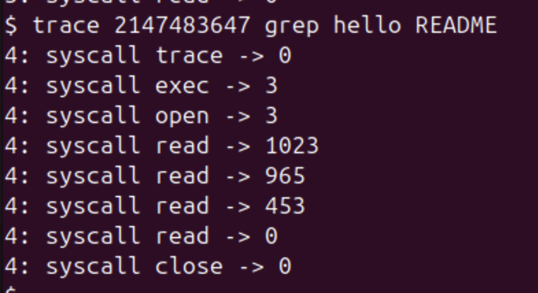</p>

<p align="center"><i>Figure 10.3.1 – Tracing every system call of grep</i></p>

Now every call is printed: trace itself (the mask is already set when the handler returns, so its own line appears), exec, which returns 3 = argc (grep, hello, README), open of README (descriptor 3), the four reads and close. There is no fork, because trace becomes grep with exec and does not create a new process.

3.3 Only write (bit 16, mask 65536), and 3.4 only open (15) and close (21), mask 2^15 + 2^21 = 32768 + 2097152 = 2129920:

```bash
$ trace 65536 echo hi
$ trace 2129920 grep hello README
```

<p align="center">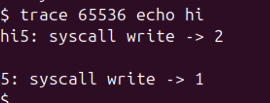</p>

<p align="center"><i>Figure 10.3.2 – Only write: echo hi</i></p>

<p align="center">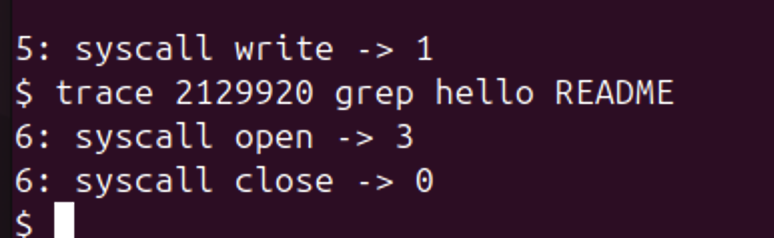</p>

<p align="center"><i>Figure 10.3.3 – Only open and close: mask 2129920</i></p>

With mask 65536 the line "5: syscall write -> 2" is printed right after "hi" and before the new line, followed by "5: syscall write -> 1". With mask 2129920 only "open -> 3" and "close -> 0" are printed, without the reads, so this is the mask asked in question 4.

3.2 Only fork (bit 1, mask 2), on the usertests test that forks until the process table is full:

```bash
$ trace 2 usertests forkforkfork
```

<p align="center">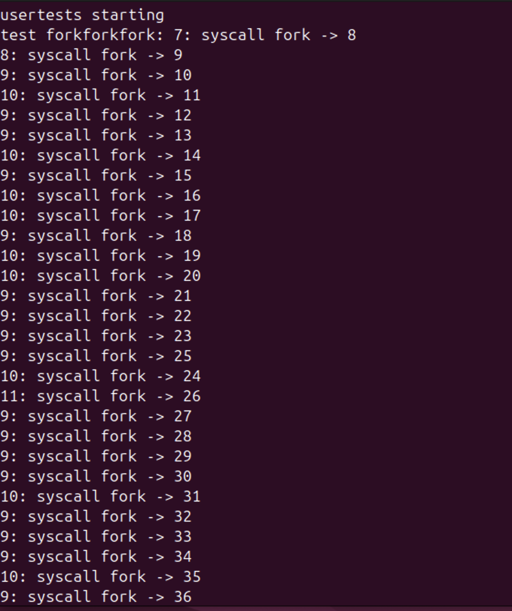</p>

<p align="center"><i>Figure 10.3.4 – forkforkfork: the beginning</i></p>

<p align="center">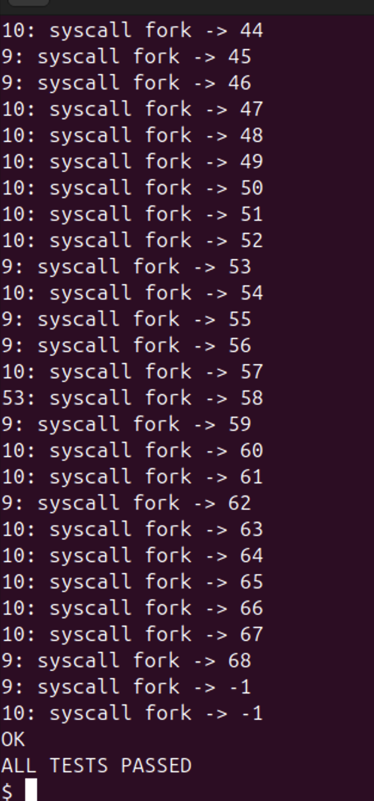</p>

<p align="center"><i>Figure 10.3.5 – forkforkfork: the end, when fork returns -1</i></p>

Lines are printed by several different pids (7, 8, 9, 10, 11, 53), all descendants of the traced usertests. The new pids go up to 68, then fork returns -1 for processes 9 and 10: the table of 64 processes (NPROC) is full. The test expects this and ends with OK and ALL TESTS PASSED. Compared with the lab sheet, all the pids are shifted by one, because more commands were run before this one.

**Answers to the questions:**

1. Because the mask 32 has only one bit on, bit 5, and 5 is SYS_read. open is call 15 and close is call 21, and their bits are 0 in the mask, so the test (p->trace_mask >> num) & 1 is false for them and nothing is printed.

2. The line np->trace_mask = p->trace_mask; added in fork (kfork) in kernel/proc.c. Every child copies the mask of its parent, so the children and grandchildren of usertests are traced too, and each of them prints its own pid.

3. echo calls write twice: once for the argument "hi" (2 bytes) and once for the final "\n" (1 byte). The trace line is printed by the kernel after each write returns, so the first trace line appears right after "hi", before the second write prints the new line.

4. The mask with bit 15 (open) and bit 21 (close): 2^15 + 2^21 = 32768 + 2097152 = 2129920. trace 2129920 grep hello README printed only open -> 3 and close -> 0.


## CONCLUSION


Lab 9 showed that everything a program does with the outside world goes through system calls. strace revealed that even a simple ls -l in an empty folder made 47 calls of only four kinds (opening its libraries, locale files and the directory) before a single write(1, ...) printed "total 0". In syscalls.c each C call open, write, read and close became exactly one system call, with open implemented as openat. The first file got descriptor 3 because 0, 1 and 2 are already open from the start.

strace -c showed that the program actually made 39 calls, most of them done by the loader and glibc before main. It also showed that the buffering of printf changes the system calls: three separate writes on the terminal, but a single write of 80 bytes when the output goes to a file.

In Lab 10 the same mechanism was built from the inside. Following the number 23 showed the whole path of a system call in xv6: the stub generated by usys.pl puts 23 in a7 and executes ecall; syscall() uses a7 as an index in the table syscalls[]; sys_trace reads its argument with argint; and the return value goes back through a0. With a mask in struct proc, a test after each call and the mask copied in fork, trace printed the calls of a command and of all its children. The values 1023, 965, 453 and 0 matched the size of README, and the masks 2, 32, 65536 and 2129920 selected exactly fork, read, write, and open with close. A practical lesson was that a long here-document pasted into the terminal can break: when the EOF line was damaged, shell commands ended up inside a kernel source file.

## REFERENCES


1. Silberschatz, A., Galvin, P. B., Gagne, G. Operating System Concepts. 10th ed. Wiley, 2018. Chapter 2.3 (system calls).

2. Kerrisk, M. The Linux Programming Interface. No Starch Press, 2010. Chapters 3 (system programming concepts), 4 (file I/O) and 13 (file I/O buffering).

3. Cox, R., Kaashoek, F., Morris, R. xv6: a simple, Unix-like teaching operating system (RISC-V version), chapter 4 "Traps and system calls". MIT. Available at: https://pdos.csail.mit.edu/6.1810/

4. MIT 6.1810 Operating System Engineering, Lab "System calls" (trace). Available at: https://pdos.csail.mit.edu/6.1810/

5. The Linux man-pages project: strace(1), syscalls(2), open(2), openat(2), write(2), read(2), setvbuf(3). Available at: https://man7.org/linux/man-pages/
